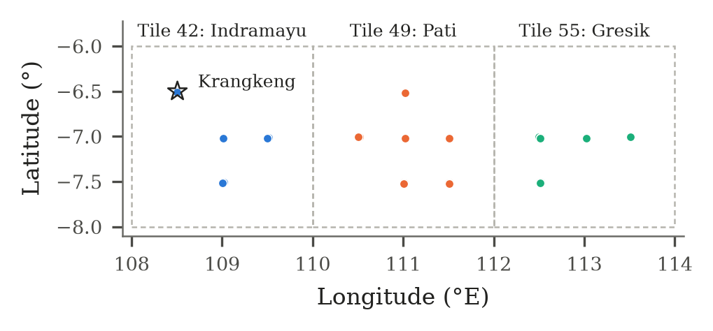
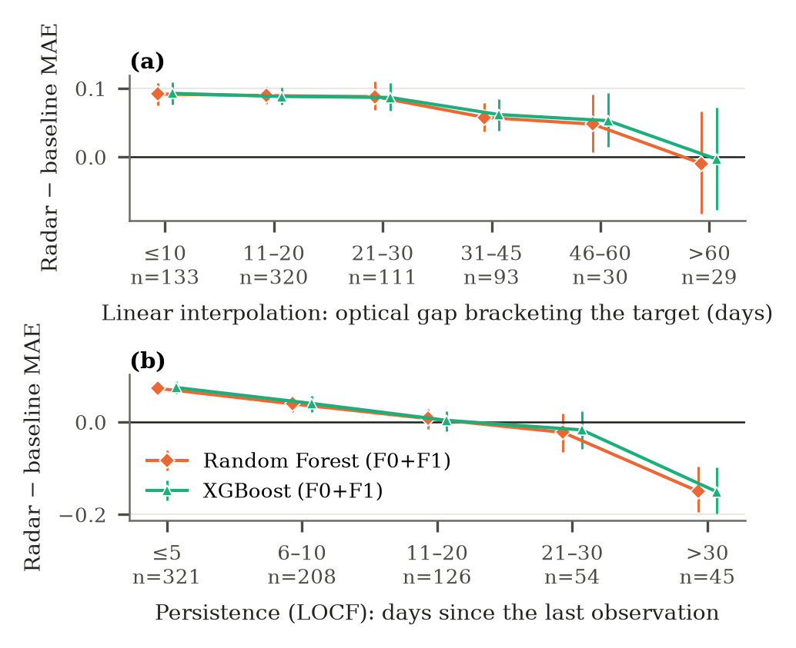
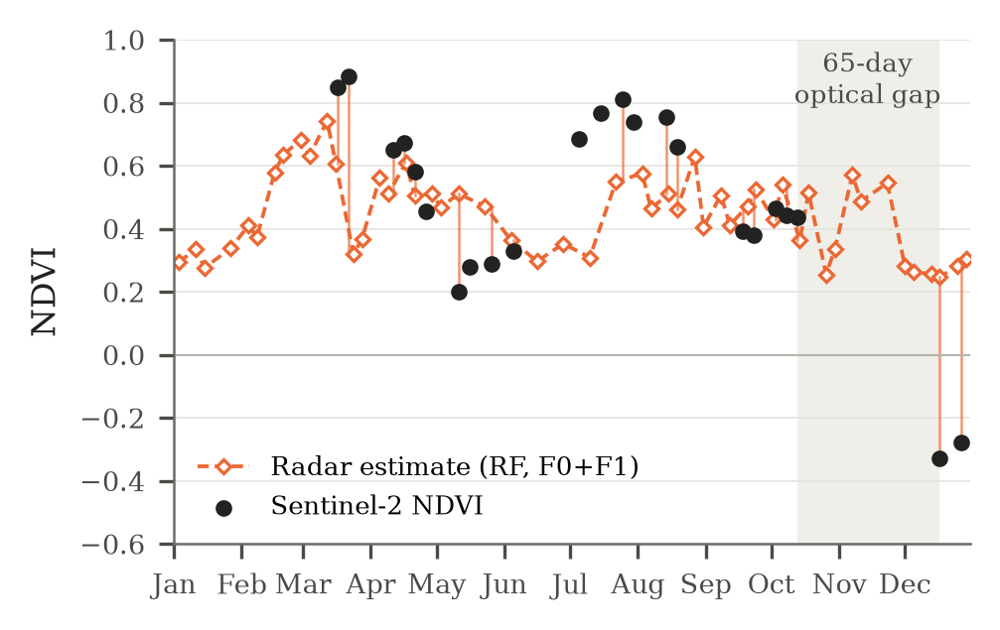

# When Does Sentinel-1 Outperform Temporal Interpolation for Rice NDVI? A Region-Held-Out Evaluation over Mapped Rice Blocks in Java

**Updated:** 2026-09-26
**Status:** First complete draft (backup, draft 1) for AGERS 2026, revised against `paper-best-practice.md`; the build verifies every table row and quoted number against the evaluation files. Every number comes from `research/private/ml-dataset/evaluation-v1/` and `docs/manuscripts/ml-paper-numbers.json`, computed from the reference-harness predictions (`sanity-run/predictions.csv`, SHA-256 in `evaluation-v1/summary.json`). The reviewer's own prediction run (spec §11.2) has not been received. If it differs, rerun `evaluate_ml.py` and `make-ml-paper-figures.py` and update the numbers. The authors and affiliations follow `research/Thesis Matani.docx` (2026-09-26); Muhammad Wildan is the supervisor. Advisor, author and venue review are pending. Bracketed provenance tags are removed when rendering.

**Authors:** Paulus Biliardo Putrakedua; Mohammad Ezzeddin Pratama; Jerry Nathanael Sugito; Muhammad Wildan — School of Information Systems, Bina Nusantara University, Tangerang, Indonesia — paulus.kedua@binus.ac.id; mohammad.pratama006@binus.ac.id; jerry.sugito@binus.ac.id; muhammad.wildan@binus.edu

## Abstract

Clouds often block Sentinel-2 over rice fields. For one mapped-rice block in Indramayu, Indonesia, only 23 dates in 2021 gave a usable NDVI value, and the longest interval between them was 65 days. This study tested whether Sentinel-1 backscatter can estimate block-mean NDVI, and how long an optical gap must be before such estimates beat temporal interpolation. Forty-three 0.36 ha blocks were sampled from the Open-SEA-Rice-10 map in three 2° regions of northern Java, giving 792 clear-sky Sentinel-2 observations with a radar pass within three days. Random Forest and XGBoost models were trained on current and earlier radar features, tested on regions left out of training, and compared with persistence, linear interpolation, linear regression and a calendar-only model. At naturally occurring gaps, interpolation (MAE 0.060) was more accurate than either radar model (0.139). When observations were removed to lengthen the gaps, radar error stayed between 0.12 and 0.14, while interpolation error rose from 0.044 to 0.210. Radar became more accurate than interpolation only when the bracketing gap reached 60 days (paired difference −0.042, 95% CI −0.059 to −0.025). The two learners performed the same, and both pulled estimates towards mid-range values. Radar estimates are therefore useful only for long optical gaps, and should be labelled as estimates.

**Keywords:** Sentinel-1; Sentinel-2; NDVI; rice; gap filling; random forest; XGBoost; spatial cross-validation.

## I. Introduction

Indonesia harvested about 10.21 million hectares of paddy in 2023 [1], and both optical and radar satellite data have been used to map rice [2]. At field level, the Normalized Difference Vegetation Index (NDVI) from the Sentinel-2 red and near-infrared bands at 10 m [3] is a common measure of canopy development. It needs a clear view of the ground, and during the monsoon the longest cloudy spells can fall in land preparation and early growth. [EVID-067; EVID-068; EVID-070]

Matani is a mobile application that shows a dated NDVI series for a saved rice field. In an earlier study of one mapped-rice block in Krangkeng, Indramayu, 23 of 71 Sentinel-2 acquisitions in 2021 passed the application's quality rule. The longest interval between qualifying observations was 65 days, and the year began with a 75-day absence. Not every rejection was traced to cloud, so the interval is not assumed to have been continuously cloudy. [OBS-69; OBS-70]

Sentinel-1 radar sees through cloud, and its cross-polarized (VH) backscatter is more sensitive to rice growth than the co-polarized (VV) signal [4]. Earlier studies regressed NDVI on Sentinel-1 backscatter [5], [6] or combined radar with optical time series to fill cloudy periods [7]–[9]. None of the studies reviewed here reports how the error compares with interpolation as the optical gap grows, and an application needs exactly that to decide when an estimate should fill a gap. A targeted search found no such analysis for Indonesian smallholder rice. [EVID-113; EVID-097; EVID-099; EVID-102; EVID-104; EVID-107; OBS-76]

This study addresses three questions for small mapped-rice blocks in Java:

1. How accurately does radar-based regression estimate NDVI in regions not used for training?
2. How does that accuracy compare with persistence and interpolation as the optical gap lengthens?
3. Can Matani present the resulting estimates separately from measurements?

Two standard learners, Random Forest [10] and XGBoost [11], were evaluated with a leave-one-region-out design, and no new algorithm is proposed. Question 3 covers software behavior only; benefit to farmers was not measured. [DEC-54; DEC-55]

## II. Related Work

Mohite et al. estimated cloud-free NDVI from Sentinel-1 VV/VH backscatter with linear, support-vector and random-forest regression, including paddy rice in Punjab and Haryana, India. Random forest gave R² 0.79 and RMSE 0.08 for rice [5]. The spatial independence of that evaluation was not verified. Roßberg and Schmitt trained a globally applicable deep network on the time-paired SEN12TP dataset and note that it neglects temporal characteristics because it predicts from a single date [6]. [EVID-097; EVID-098; EVID-099; EVID-100]

Other studies combine radar with optical history. Tsardanidis et al. used a CNN–RNN for Lithuanian grassland and outperformed linear, Akima and quadratic interpolation [7]. Chen et al. evaluated the bidirectional recurrent BRIOS model under random gaps and two fixed continuous gap periods per site [8]. Chen et al. also combined Sentinel-1, Sentinel-2 and environmental data in an ensemble framework [9], and Chu et al. reconstructed MODIS NDVI in cloud-prone mainland Southeast Asia by tensor completion [12]. The closest rice study, by Brinkhoff, estimated Sentinel-2 vegetation indices for rice from Sentinel-1 and field dates, testing on a later season than training. Day of season alone outperformed SAR for the red-edge chlorophyll index, and fusing both with field dates performed best [13]. In Indonesia, Thorp and Drajat mapped paddy production stages across West Java with Sentinel data [14], which is a classification task. [EVID-102; EVID-104; EVID-105; EVID-107; EVID-106; EVID-108; EVID-101]

Neighbouring fields and shared dates produce correlated samples. Random cross-validation on such data can underestimate prediction error, so blocked designs are recommended [15]. [EVID-114]

## III. Data and Methods

### A. Study area and sampling

Blocks were sampled from the 2021 Open-SEA-Rice-10 rice cropping-intensity map [16], [17] in three 2° tiles of northern Java (Fig. 1). A block was a non-overlapping 6 × 6-cell square of 0.36 ha in which all 36 cells were mapped as rice. Of nine fixed windows per tile, the 14 windows with at least five eligible blocks each contributed three evenly spaced blocks, giving 42 pool blocks. The Krangkeng block from the earlier study was added as a showcase block and excluded from training and tuning. The selection rule was fixed before any satellite value was extracted, and no block was removed afterwards. [EVID-060; EVID-061; DEC-54; CODE: research/scripts/select-ml-blocks.mjs]

### B. Optical reference

Sentinel-2 Level-2A statistics were retrieved from the Copernicus Data Space Ecosystem Statistical API [3], [18]. NDVI was computed from B04 and B08 at 10 m, excluding Scene Classification Layer classes 0, 1, 3, 8, 9 and 10 [19]. Class 6 (water) was retained because flooded paddies are genuine low-NDVI observations. The block mean served as the reference when at least 80% of its 36 pixels were valid. The re-extraction for Krangkeng reproduced the earlier study's 71 acquisitions and 23 qualifying dates, with NDVI values within 5 × 10⁻⁵. [EVID-070; EVID-093; EVID-094; HYP: target-v1; DEC-54 pilot OBS]

### C. Radar features

Sentinel-1 GRD data (IW mode, dual polarization) were processed to terrain-flattened γ⁰, orthorectified on the Copernicus 30 m DEM with no speckle filter, and radar-shadow pixels were excluded [20]. The API returns linear power, so block means were averaged in linear units before conversion to decibels (1). [EVID-109]

EQ: γ⁰[dB] = 10 · log₁₀( mean γ⁰[linear] )    (1)

Three feature groups were defined before model fitting. F0 describes the current pass: VV, VH, VH − VV in decibels, local incidence angle and orbit direction. F1 describes radar history from the same orbit direction, using only passes up to the matched pass: the previous two VH values, the latest VH change, the 60-day VH minimum and the days since that minimum, which captures pre-transplanting flooding. F2 encodes day of year as sine and cosine.

Radar from October to December 2020 supplied history for January 2021, and no optical value entered any feature. Four sets were compared: F0, F0+F1 (primary), F0+F1+F2 and F2 alone. [SPEC §5; CODE: research/lib/cdse-s1.mjs]

### D. Pairing

Each reference was paired with the nearest Sentinel-1 pass from either orbit direction within ±3 days, taking the earlier pass on ties. Unmatched dates remained in the inventory. Both orbit directions were used because a single direction matched 12 of Krangkeng's 23 qualifying dates, compared with 18 for both. [HYP: ±3 d; DEC-54]

### E. Models and validation

Models were evaluated by leave-one-tile-out cross-validation and tuned only within the training tiles, using three-fold cross-validation grouped by window. Random Forest (scikit-learn [21], 300 trees) searched 18 configurations. XGBoost searched 12 configurations with subsampling of 0.8; early stopping used the inner validation folds only, and the final refit used the mean inner tree count. Both learners received identical rows and features. Each chosen configuration was refitted with seeds 0–4, and the five predictions were averaged. The showcase block was predicted by the tile-42 models. Automated checks confirmed that no block appeared in both training and test data, that radar history used only earlier passes, and that each prediction came from exactly one outer fold. [SPEC §6–7, §9; CODE: research/ml-handoff/example_train.py; CODE: research/scripts/evaluate_ml.py]

### F. Baselines and metrics

Four baselines were compared with the radar models. B1 (persistence) carries the last earlier reference forward. B2 (linear interpolation) uses the nearest earlier and later references, so it can only be computed after the fact. B3 (calendar-only) is Random Forest trained on F2 alone. B4 is ordinary least squares on F0 under the same folds. B1 and B2 used every reference of the block except the target date. Methods were compared on the rows where all were available. Mean absolute error (MAE) was the primary metric, with root-mean-square error (RMSE), mean signed error (bias) and R². MAPE was restricted to references of at least 0.2 because flooded paddies have NDVI near or below zero. [HYP: 0.2; SPEC §8.1]

### G. Gap experiment and uncertainty

For each pool row and gap length L of 0, 10, 20, 30 or 60 days, all references within ±L/2 days of the target were hidden, and B1 and B2 were recomputed. L = 0 hides the target date only. The effective gap is the interval between the remaining bracketing references. Radar predictions did not change, because no radar feature uses optical data. Events were grouped into effective-gap bins of 10–20, 20–30, 30–45, 45–60, 60–90 and ≥90 days, with each date counted once per bin. Confidence intervals were 95% percentile intervals from 2,000 cluster-bootstrap resamples of blocks within tiles. Methods were compared by paired per-event differences in absolute error. The crossover is the shortest bin whose paired-difference interval lies entirely below zero. [HYP: bins; SPEC §8.3–8.4]

### H. Integration in Matani

Estimates are stored in a separate table with their target date, radar acquisition, model, feature set, run identifiers, evaluation role and provenance. The application draws them only on the NDVI chart, as dashed hollow diamonds with a text legend. A measurement within three days takes precedence, and estimates are excluded from latest-value summaries. [DEC-55; CODE: supabase/migrations/20260926000100_ndvi_estimates.sql; CODE: app/detail-lahan-page.tsx]

## IV. Results

### A. Dataset

Table I summarizes the inventory. Of all block-acquisitions, 36.9% met the validity rule, and 68.9% of those were paired with a radar pass. Pool blocks contributed 12 to 26 rows each (774 in total), and the showcase block contributed 18. Passes were split evenly between orbit directions (395 ascending, 397 descending), and the median absolute offset was 1.2 days. November to April contributed 39% of rows. Reference NDVI ranged from −0.53 on flooded paddies to 0.997. [EVAL: ml-paper-numbers.json]

TABLE: Table I. Observation inventory by tile, 2021
| Tile | Blocks | Windows | S2 block-acquisitions | ≥80% valid | Radar-matched rows |
|---|---|---|---|---|---|
| 42 | 13 | 4 | 923 | 331 | 215 |
| 49 | 18 | 6 | 1,314 | 518 | 338 |
| 55 | 12 | 4 | 876 | 301 | 239 |
| Total | 43 | 14 | 3,113 | 1,150 | 792 |

### B. Accuracy at natural gaps

Interpolation was the most accurate method on the 700 rows where all methods were available (Table II). Random Forest and XGBoost did not differ: with F0+F1, their paired difference was 0.0001 (CI −0.0020 to 0.0021). Radar history reduced Random Forest MAE by 0.014 relative to F0 (CI −0.022 to −0.007), whereas calendar terms added nothing once history was present (−0.001, with an interval spanning zero). Radar F0+F1 was 0.040 more accurate than the calendar-only model (CI −0.053 to −0.027), and with F0 alone Random Forest was 0.008 more accurate than linear regression (CI −0.013 to −0.002). Excluding two implausibly high references (0.978 and 0.997) changed no MAE by more than 0.001. [EVAL: metrics.csv; EVAL: ml-paper-numbers.json paired_natural_gap]

TABLE: Table II. Test accuracy at natural gaps, pooled over held-out tiles (700 rows, 42 blocks)
| Method | MAE [95% CI] | RMSE | Bias | R² | MAPE (%) |
|---|---|---|---|---|---|
| B1 Persistence | 0.109 [0.097, 0.121] | 0.166 | +0.003 | 0.36 | 23.0 |
| B2 Linear interpolation | 0.060 [0.052, 0.067] | 0.093 | −0.001 | 0.80 | 12.0 |
| B3 Calendar only (RF, F2) | 0.179 [0.163, 0.195] | 0.218 | −0.005 | −0.10 | 36.1 |
| B4 Linear regression (F0) | 0.161 [0.148, 0.174] | 0.196 | −0.008 | 0.11 | 32.7 |
| RF, F0 | 0.153 [0.142, 0.165] | 0.186 | −0.007 | 0.20 | 32.6 |
| RF, F0+F1 | 0.139 [0.129, 0.149] | 0.172 | −0.004 | 0.32 | 29.7 |
| RF, F0+F1+F2 | 0.138 [0.127, 0.149] | 0.171 | −0.002 | 0.33 | 29.6 |
| XGBoost, F0 | 0.152 [0.140, 0.163] | 0.185 | −0.008 | 0.21 | 32.3 |
| XGBoost, F0+F1 | 0.139 [0.129, 0.149] | 0.170 | −0.004 | 0.33 | 29.6 |
| XGBoost, F0+F1+F2 | 0.139 [0.128, 0.151] | 0.171 | −0.005 | 0.33 | 29.6 |

The ranking held in every held-out tile. Random Forest with F0+F1 reached MAE 0.138, 0.132 and 0.150 on tiles 42, 49 and 55, compared with 0.076, 0.055 and 0.053 for interpolation. Radar error depended strongly on the NDVI level. Random Forest overestimated the lowest reference tercile (NDVI < 0.37) by +0.143 on average and underestimated the highest (NDVI ≥ 0.59) by −0.165, while its MAE in the middle tercile was 0.089, similar to the calendar-only model's 0.078. Error did not increase with pairing offset: MAE was 0.144 for offsets up to one day and 0.135 for offsets of one to three days. [EVAL: metrics.csv]

### C. Error as the optical gap lengthens

Interpolation was significantly more accurate in every bin up to and including 45–60 days (Fig. 2, Table III). From the 60–90-day bin onward, both radar learners were more accurate. Linear regression and the calendar-only model also beat interpolation at long gaps, by 0.021 at 60–90 days and 0.039 beyond 90 days respectively, but radar F0+F1 remained 0.03–0.05 more accurate than the calendar-only model in every bin. Persistence matched radar at 30–45 days and was less accurate beyond that. Interpolation was available for 700 of 774 pool rows with no references hidden, and for 577 with 60 days hidden. [EVAL: gap_summary.csv; EVAL: gap_availability.csv]

TABLE: Table III. Paired absolute-error difference between radar and interpolation by effective gap
| Gap (days) | Events | B2 MAE | RF MAE | RF − B2 [95% CI] | XGB − B2 [95% CI] |
|---|---|---|---|---|---|
| 10–20 | 334 | 0.044 | 0.134 | +0.091 [0.077, 0.104] | +0.089 [0.076, 0.102] |
| 20–30 | 382 | 0.054 | 0.134 | +0.080 [0.068, 0.092] | +0.078 [0.067, 0.090] |
| 30–45 | 486 | 0.074 | 0.138 | +0.064 [0.055, 0.074] | +0.065 [0.056, 0.074] |
| 45–60 | 359 | 0.117 | 0.134 | +0.017 [0.005, 0.030] | +0.018 [0.006, 0.030] |
| 60–90 | 475 | 0.179 | 0.137 | −0.042 [−0.059, −0.025] | −0.041 [−0.057, −0.025] |
| ≥ 90 | 171 | 0.210 | 0.120 | −0.089 [−0.113, −0.065] | −0.087 [−0.110, −0.064] |

### D. Krangkeng showcase block

On the 16 showcase rows where interpolation was available, Random Forest with F0+F1 reached MAE 0.193, compared with 0.056 for interpolation. Its MAE on all 18 paired dates was 0.216. The model missed the first-season peak (0.85 and 0.89 in March) and the two flooded December dates (−0.33 and −0.28), which it estimated at 0.25 and 0.28 (Fig. 3).

No optical observation qualified in the shaded interval of Fig. 3, so the estimates there cannot be checked. Within this interval, the ten estimates ranged from 0.26 to 0.57 and changed by up to 0.26 within eight days. The spread across the five seeds averaged 0.017, so these jumps are not seed noise. [EVAL: metrics.csv; EVAL: ml-paper-numbers.json krangkeng]

## V. Discussion

### A. When radar helps

Interpolation does well at short gaps because it uses the block's own observations on both sides of the target, and rice NDVI changes gradually over a few weeks. The radar models apply a relationship learned in other regions and do not use optical data, so their error stays roughly constant however long the gap is. Interpolation error keeps growing and overtakes it at about 60 days. That threshold assumes an observation after the target is already available. In live monitoring, interpolation is not possible and the fair comparison is persistence, which matched radar at 30–45 days, so the real-time threshold is probably shorter, although this was not tested.

Random Forest and XGBoost gave the same error, and the only consistent gain came from adding radar history. This fits the note by Roßberg and Schmitt [6] that single-date prediction ignores temporal information. Brinkhoff found that day of season alone outperformed SAR for the red-edge chlorophyll index of rice [13], but that study knew each field's sowing, ponding and panicle-initiation dates, while the calendar features here are day of year only. At long gaps even the calendar-only model beat interpolation, so the stronger evidence for radar is that it beat the calendar model at every gap length.

### B. Error structure and limits

An MAE near 0.14 is large for rice NDVI. Because the estimates are pulled towards mid-range values, they understate both flooded fields and full canopy. They can show roughly where a field is in its season, but cannot stand in for a clear observation. The error is higher than that reported by Mohite et al. [5], whose split design, crop, block size and region differ, and testing on unseen regions with 36-pixel blocks is expected to give higher error than random splitting [15].

The principal limitation is that NDVI references exist only on clear days, mostly in the dry season, so the error inside cloudy periods is unknown. The blocks were also chosen from a map built partly from Sentinel-1 VH and Sentinel-2 NDVI [16], which favours contiguous, clearly identified rice, and the study covers three regions in one year. The NDVI reference has its own errors from scene classification and edge pixels, and the 80% validity rule, the ±3-day window and the gap bins were set without calibration. [SPEC §10 T1–T7]

### C. Implications for Matani

The results suggest three changes to how Matani shows estimates: show one only where the optical gap is longer than about 60 days, display its evaluated error next to it, and do not join estimates with a line that suggests a precise trajectory. The estimate table, importer and chart logic pass automated tests. The Krangkeng estimates have not yet been imported into the production database or checked on a device, so the feature is tested but not deployed. [DEC-55; CODE: tests/estimate-timeline.test.mjs; CODE: tests/import-ndvi-estimates.test.mjs; OBS-77]

## VI. Conclusion

This study evaluated Sentinel-1 estimation of block-mean NDVI for 43 mapped-rice blocks in three regions of northern Java during 2021, using 792 radar–optical pairs and testing on held-out regions. Random Forest and XGBoost reached an MAE of 0.139, whereas retrospective interpolation reached 0.060 at naturally occurring gaps. Radar was more accurate than interpolation only when the bracketing optical gap was about 60 days or longer. The results rest on clear-sky references, so they do not show how accurate the estimates are during cloudy wet-season periods or for fragmented smallholder parcels. The next steps are testing in cloudy periods, other years and parcel types, temporal smoothing with calibrated uncertainty, and a real-time comparison with persistence.

## Data and Code Availability

The derived dataset, predictions, scripts and processing records are stored in the team's research archive and are not publicly deposited at this time. Sentinel-1 and Sentinel-2 data are available from the Copernicus programme, and Open-SEA-Rice-10 is available under CC-BY-4.0 [17].

## References

[1] BPS-Statistics Indonesia, “In 2023, paddy harvested area was approximately 10.21 million hectares with 53.98 million tons of dry unhusked paddy (GKG) production,” Mar. 1, 2024. https://www.bps.go.id/en/pressrelease/2024/03/01/2375/pada-2023--luas-panen-padi-mencapai- [EVID-067]

[2] R. Zhao, Y. Li, and M. Ma, “Mapping paddy rice with satellite remote sensing: A review,” Sustainability, vol. 13, no. 2, art. 503, 2021, doi: 10.3390/su13020503. [EVID-068]

[3] Copernicus Data Space Ecosystem, “Sentinel-2 L2A,” technical documentation, accessed Sep. 17, 2026. https://documentation.dataspace.copernicus.eu/APIs/SentinelHub/Data/S2L2A.html [EVID-070]

[4] D. B. Nguyen, A. Gruber, and W. Wagner, “Mapping rice extent and cropping scheme in the Mekong Delta using Sentinel-1A data,” Remote Sensing Letters, vol. 7, no. 12, pp. 1209–1218, 2016, doi: 10.1080/2150704X.2016.1225172. [EVID-113]

[5] J. Mohite, S. Sawant, A. Pandit, and S. Pappula, “Investigating the performance of random forest and support vector regression for estimation of cloud-free NDVI using Sentinel-1 SAR data,” Int. Arch. Photogramm. Remote Sens. Spatial Inf. Sci., vol. XLIII-B3-2020, pp. 1379–1383, 2020, doi: 10.5194/isprs-archives-XLIII-B3-2020-1379-2020. [EVID-097]

[6] T. Roßberg and M. Schmitt, “A globally applicable method for NDVI estimation from Sentinel-1 SAR backscatter using a deep neural network and the SEN12TP dataset,” PFG – J. Photogramm. Remote Sens. Geoinf. Sci., vol. 91, pp. 171–188, 2023, doi: 10.1007/s41064-023-00238-y. [EVID-099]

[7] I. Tsardanidis, A. Koukos, V. Sitokonstantinou, T. Drivas, and C. Kontoes, “Cloud gap-filling with deep learning for improved grassland monitoring,” Computers and Electronics in Agriculture, vol. 230, art. 109732, 2025, doi: 10.1016/j.compag.2024.109732. [EVID-102]

[8] Y. Chen et al., “A new deep learning-based model for reconstructing high-quality NDVI time-series data in heavily cloudy areas: Fusion of Sentinel 1 and 2 data,” International Journal of Digital Earth, vol. 17, art. e2407941, 2024, doi: 10.1080/17538947.2024.2407941. [EVID-104]

[9] D. Chen et al., “Crop NDVI time series construction by fusing Sentinel-1, Sentinel-2, and environmental data with an ensemble-based framework,” Computers and Electronics in Agriculture, vol. 215, art. 108388, 2023, doi: 10.1016/j.compag.2023.108388. [EVID-107]

[10] L. Breiman, “Random forests,” Machine Learning, vol. 45, no. 1, pp. 5–32, 2001, doi: 10.1023/A:1010933404324. [EVID-110]

[11] T. Chen and C. Guestrin, “XGBoost: A scalable tree boosting system,” in Proc. 22nd ACM SIGKDD Int. Conf. Knowledge Discovery and Data Mining, 2016, pp. 785–794, doi: 10.1145/2939672.2939785. [EVID-111]

[12] D. Chu et al., “Long time-series NDVI reconstruction in cloud-prone regions via spatio-temporal tensor completion,” Remote Sensing of Environment, vol. 264, art. 112632, 2021, doi: 10.1016/j.rse.2021.112632. [EVID-106]

[13] J. Brinkhoff, “Improving real-time rice crop monitoring by fusing Sentinel-1, Sentinel-2 and field data,” in Proc. IEEE Int. Geoscience and Remote Sensing Symp. (IGARSS), 2025, pp. 1482–1486, doi: 10.1109/IGARSS55030.2025.11243072. [EVID-108]

[14] K. R. Thorp and D. Drajat, “Deep machine learning with Sentinel satellite data to map paddy rice production stages across West Java, Indonesia,” Remote Sensing of Environment, vol. 265, art. 112679, 2021, doi: 10.1016/j.rse.2021.112679. [EVID-101]

[15] D. R. Roberts et al., “Cross-validation strategies for data with temporal, spatial, hierarchical, or phylogenetic structure,” Ecography, vol. 40, no. 8, pp. 913–929, 2017, doi: 10.1111/ecog.02881. [EVID-114]

[16] F. I. Ginting et al., “High-resolution maps of rice cropping intensity across Southeast Asia,” Scientific Data, vol. 12, art. 1408, 2025, doi: 10.1038/s41597-025-05722-1. [EVID-061]

[17] F. I. Ginting et al., “Open-SEA-Rice-10: Open access high-resolution maps of rice harvested area and cropping intensity in Southeast Asia,” dataset, Zenodo, record 14627003, 2025, doi: 10.5281/zenodo.14627003. [EVID-060]

[18] Sentinel Hub, “Statistical API,” documentation, accessed Sep. 17, 2026. https://docs.sentinel-hub.com/api/latest/api/statistical/ [EVID-094]

[19] Sentinel Hub, “Sentinel-2 L2A Scene Classification Map,” Custom Scripts, accessed Sep. 17, 2026. https://custom-scripts.sentinel-hub.com/custom-scripts/sentinel-2/scene-classification/ [EVID-093]

[20] Copernicus Data Space Ecosystem, “Sentinel-1 GRD,” technical documentation, accessed Sep. 26, 2026. https://documentation.dataspace.copernicus.eu/APIs/SentinelHub/Data/S1GRD.html [EVID-109]

[21] F. Pedregosa et al., “Scikit-learn: Machine learning in Python,” Journal of Machine Learning Research, vol. 12, pp. 2825–2830, 2011. https://jmlr.org/papers/v12/pedregosa11a.html [EVID-112]
