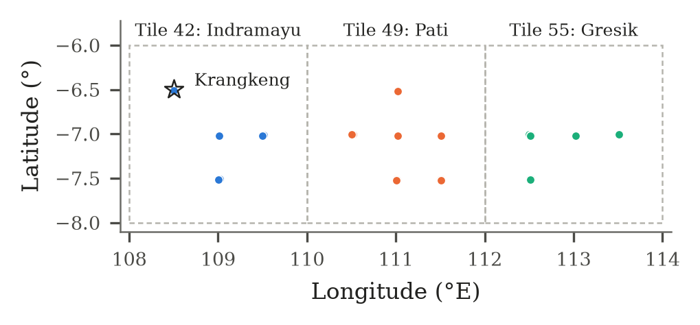
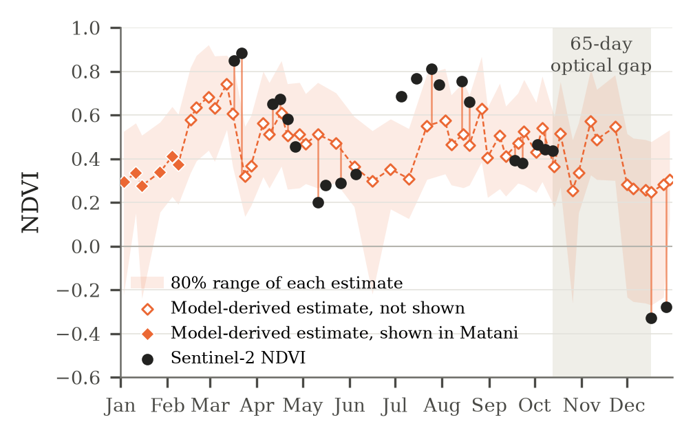
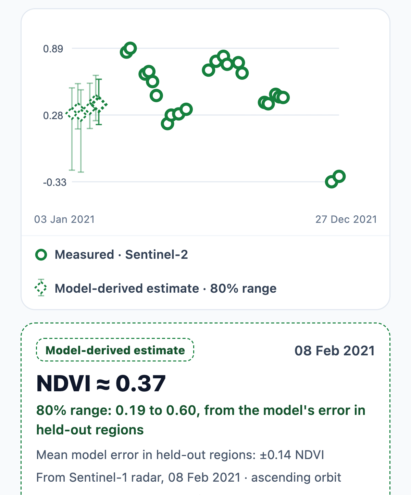

# When to Show Sentinel-1 NDVI Estimates in Rice Monitoring: Gap-Length Crossovers against Persistence and Interpolation in Java

**Updated:** 2026-09-29
**Status:** Draft 14 for AGERS 2026: draft 13 (reviewer's 12-ablation pipeline, DEC-61/OBS-89, with block-bootstrap intervals; Matani's two display rules, DEC-62), which GPT-6 Astra reviewed CLEAN in round 13, plus that round's three Nits (N39 leading-gap terminology, N40 in-gap seed-spread scope, and supporting-text wording), the acknowledged collaborator's name, a neutral model version in Fig. 4, and a pass removing repeated explanations and unnatural phrasing (2026-09-29). Supersedes drafts 1–11 (team-run-v2-final and the gap-masking experiment, kept on disk for audit). The build verifies selected table rows and quoted values against `docs/manuscripts/ml-paper-numbers.json`. Bracketed provenance tags are removed when rendering.

**Authors:** Paulus Biliardo Putrakedua; Mohammad Ezzeddin Pratama; Jerry Nathanael Sugito; Muhammad Wildan — School of Information Systems, Bina Nusantara University, Tangerang, Indonesia — paulus.kedua@binus.ac.id; mohammad.pratama006@binus.ac.id; jerry.sugito@binus.ac.id; muhammad.wildan@binus.edu

## Abstract

Cloud cover frequently interrupts Sentinel-2 observation of rice fields. For one mapped-rice block in Indramayu, Indonesia, only 23 dates in 2021 gave a usable NDVI value, and the longest interval between them was 65 days. This study tested whether Sentinel-1 backscatter can estimate block-mean NDVI, and from what optical-gap length such estimates beat two simple alternatives: the last observation carried forward (persistence) and linear interpolation, which is retrospective. Forty-three 0.36 ha blocks in three 2° regions of northern Java gave 792 clear-sky Sentinel-2 optical references with a radar pass within three days. Random Forest and XGBoost were trained on four feature sets with five seeds and tested on regions left out of training. With current and earlier radar features, Random Forest reached MAE 0.143 (95% CI 0.132 to 0.153) and R² 0.32. No difference between the learners was detected, and radar history reduced error by 0.015. In the observed gap bins, interpolation was more accurate than radar up to 60 days, and no difference was detected beyond that; a fitted linear crossover at 79 days (CI 58 to 152) is exploratory only. Against persistence, radar was clearly more accurate only in gaps longer than 30 days (error 0.150 lower), while the fitted crossover was at a gap age of about 19 days (CI 17 to 23). That advantage held when any block or acquisition date was left out, without flooded references, and against persistence adjusted by the radar change. Matani, a prototype field-monitoring application, applies these results as provisional display rules for model-derived estimates, each shown with an empirical 80% range: open gaps of at least 20 days after the last observation and 30 days before the first, and bracketed gaps of at least 80 days pending more long-gap observations. [EVAL: research/scripts/revision_analyses.py → revision-2026-11/analyses.json]

**Index Terms:** Sentinel-1, Sentinel-2, NDVI, Rice Monitoring, Gap Filling, Persistence, Random Forest, XGBoost, Spatial Cross-Validation

## I. Introduction

Indonesia harvested about 10.21 million hectares of paddy in 2023 [1], and both optical and radar satellite data have been used to map rice [2]. At field level, the Normalized Difference Vegetation Index (NDVI) from the Sentinel-2 red and near-infrared bands at 10 m [3] is a common measure of canopy development. Optical observations need a clear view of the ground, which clouds often prevent. [EVID-067; EVID-068; EVID-070]

Matani is a mobile application that shows a dated NDVI series for a saved rice field, displaying a value only when enough valid pixels pass its quality rule. For one mapped-rice block in Krangkeng, Indramayu, 23 of 71 Sentinel-2 acquisitions in 2021 passed that rule. The longest interval between qualifying observations was 65 days, and the year began with a 75-day absence. These gaps combine absent and quality-rejected acquisitions, so they do not necessarily indicate continuous cloud cover. [OBS-69; OBS-70]

Sentinel-1 radar sees through cloud, and its cross-polarized (VH) backscatter is more sensitive to rice growth than the co-polarized (VV) signal [4]. Earlier studies regressed NDVI on Sentinel-1 backscatter [5], [6] or combined radar with optical time series to fill cloudy periods [7]–[10]. For leaf area index, radar fusion has been reported to help most over long gaps [11]. For NDVI, none of the studies reviewed here reports how the error compares with persistence and interpolation as the optical gap grows, which an application needs to decide when an estimate should fill a gap. A targeted search found no such analysis for Indonesian smallholder rice. [EVID-113; EVID-097; EVID-099; EVID-102; EVID-104; EVID-107; OBS-76]

This study therefore treats gap filling as a display decision rather than only a prediction task, and addresses three questions for small mapped-rice blocks in Java:

1) How accurately does radar-based regression estimate NDVI in regions not used for training, and how much do the learner, the features and the validation design matter?
2) From what optical-gap length is a radar estimate more accurate than persistence or interpolation?
3) How can a field-monitoring application use these results to decide when, and how, to show an estimate?

Random Forest [12] and XGBoost [13] were selected as established, lightweight learners and evaluated with a leave-one-region-out design. The contributions are threefold:

1) A region-held-out evaluation of Sentinel-1 estimation of block-mean NDVI over mapped rice in three regions of Java, with learner, feature-set, seed, robustness and validation-design comparisons.
2) Natural-gap comparisons with persistence and interpolation that estimate, with confidence intervals, the gap length at which radar estimates become more accurate than each.
3) Matani, a prototype field-monitoring application that turns these crossovers into provisional display rules: a model-derived estimate is shown only within a long optical gap, with an empirical 80% range from held-out errors, and kept separate from measurements.

Effects on farm decisions are outside the scope of this study. [DEC-54; DEC-55; DEC-61]

## II. Related Work

Mohite et al. estimated cloud-free NDVI from Sentinel-1 VV/VH backscatter with linear, support-vector and random-forest regression, including paddy rice in Punjab and Haryana, India. Random forest gave R² 0.79 and RMSE 0.08 for rice [5]. Roßberg and Schmitt trained a globally applicable deep network on the time-paired SEN12TP dataset and note that it neglects temporal characteristics because it predicts from a single date [6]. [EVID-097; EVID-098; EVID-099; EVID-100]

Other studies combine radar with optical history. Scarpa et al. estimated NDVI from Sentinel-1 and Sentinel-2 sequences with a CNN over Burkina Faso, comparing causal and non-causal fusion schemes [10], and Pipia et al. fused radar and optical time series for leaf area index with multi-output Gaussian processes, finding the largest gain over long gaps [11]. A CNN–RNN outperformed linear, Akima and quadratic interpolation for grassland [7], and recurrent, ensemble and tensor-completion methods have reconstructed NDVI series in cloudy regions [8], [9], [14]. The closest rice study, by Brinkhoff [15], estimated Sentinel-2 vegetation indices for rice from Sentinel-1 and field dates, testing on a later season than training. Day of season alone outperformed SAR for the red-edge chlorophyll index, and fusing both with field dates performed best. In Indonesia, Thorp and Drajat mapped paddy production stages across West Java with Sentinel data [16], which is a classification task. [EVID-102; EVID-104; EVID-105; EVID-107; EVID-106; EVID-108; EVID-101]

Neighbouring fields and shared dates produce correlated samples. Random cross-validation on such data can underestimate prediction error, so blocked designs are recommended [17]. [EVID-114]

## III. Data and Methods

### A. Study area and sampling

Blocks were sampled from the 2021 Open-SEA-Rice-10 rice cropping-intensity map [18], [19] in three 2° tiles of northern Java (Fig. 1). A block was a non-overlapping 6 × 6-cell square of 0.36 ha in which all 36 cells were mapped as rice. Each tile was divided into nine fixed windows, 27 in total. The 14 windows that held at least five eligible blocks each contributed three evenly spaced blocks, giving 42 pool blocks. The Krangkeng block described in Section I was added as a showcase block and excluded from training and tuning. The selection rule was fixed before any satellite value was extracted, and no block was removed afterwards. [EVID-060; EVID-061; DEC-54; CODE: research/scripts/select-ml-blocks.mjs]

### B. Optical reference

Sentinel-2 Level-2A statistics were retrieved from the Copernicus Data Space Ecosystem Statistical API [3], [20]. NDVI was computed from B04 and B08 at 10 m, excluding Scene Classification Layer classes 0, 1, 3, 8, 9 and 10 [21]. Class 6 (water) was retained because flooded paddies are genuine low-NDVI observations. The block mean served as the optical reference when at least 80% of its 36 pixels were valid, and such dates are called qualifying observations. The reference has its own errors (Section V-B), so accuracy is reported against it rather than against field measurements. [EVID-070; EVID-093; EVID-094; HYP: target-v1; DEC-54 pilot OBS]

### C. Radar features

Sentinel-1 GRD data (IW mode, dual polarization) were processed to terrain-flattened γ⁰, orthorectified on the Copernicus 30 m DEM with no speckle filter, and radar-shadow pixels were excluded [22]. The API returns linear power, so block means were averaged in linear units before conversion to decibels (1). [EVID-109]

EQ: γ⁰[dB] = 10 · log₁₀( mean γ⁰[linear] )    (1)

Three feature groups were defined before model fitting. F0 describes the current pass: VV, VH, VH − VV in decibels, local incidence angle and orbit direction. F1 describes radar history from the same relative orbit, using passes at or before the matched pass: the previous two VH values, the latest VH change, the 60-day VH minimum, which may be the matched pass itself, and the days since that minimum, intended to capture the low backscatter of flooded fields before transplanting. History is grouped by relative orbit because two descending tracks with different incidence angles (about 32–35° and 45–48°) overlap three tile-55 blocks. F2 encodes day of year as sine and cosine.

Radar from October to December 2020 supplied history for January 2021, and no optical value entered any feature. Four sets were compared: F0, F0+F1 (primary), F0+F1+F2 and F2 alone, the last serving as a calendar-only reference. [SPEC §5; CODE: research/lib/cdse-s1.mjs]

### D. Pairing

Each reference was paired with the nearest Sentinel-1 pass from either orbit direction within ±3 days, taking the earlier pass on ties. Unmatched dates remained in the inventory. Because the nearest pass could fall up to three days after the optical date, as it did for 383 of 792 pairs, an estimate uses information available at the radar pass, not necessarily at the optical date. In live use, an estimate is dated at its radar pass and uses no later radar, so the offset affects only how estimates were matched to references in this evaluation. Both orbit directions were used because a single direction matched 12 of Krangkeng's 23 qualifying dates, compared with 18 for both. [HYP: ±3 d; DEC-54]

### E. Models and validation

Each tile was held out in turn, and models were trained on the pool blocks of the other two tiles. Hyperparameters were tuned only within the training tiles, by three-fold cross-validation grouped by window, and selected by inner-fold MAE. Random Forest (RF; scikit-learn [23], 300 trees) searched 18 configurations of depth, leaf size and features per split. XGBoost (XGB) searched 12 configurations of learning rate, depth and minimum child weight with subsampling of 0.8; early stopping monitored the inner validation folds, and the final model used the mean inner tree count. Both learners received identical rows under all four feature sets, and each chosen configuration was refitted with five seeds (0–4). The showcase block was predicted by the tile-42 models. Metrics were computed per seed and averaged over the five seeds, and across seeds the standard deviation of MAE was below 0.0011. Seed variation was therefore negligible next to the bootstrap intervals (Section III-G), and the seeds serve as a stability check rather than a source of uncertainty. The authors re-executed the experiment pipeline (Acknowledgment), which reproduced the Random Forest MAE to within 0.0002. [DEC-61; OBS-89; CODE: research/pipelines/primary/01RfVsXgbLeaveOneTileOut.ipynb]

### F. Baselines and optical gaps

Radar was compared with two simple baselines. Persistence carries the most recent qualifying observation before the target forward (last observation carried forward, LOCF). Linear interpolation uses the nearest qualifying observations before and after the target and is therefore retrospective: it is not available in live monitoring, where no later observation exists, and describes what a completed record allows. Both used qualifying observations whether or not they had a radar match, and never the target date itself. For each target, the gap age is the number of days since the previous observation, and the bracketing gap is the interval between the previous and next observations. Persistence was available for 754 of the 792 rows and interpolation for 716. Radar was compared with persistence in bins of gap age (≤5, 6–10, 11–20, 21–30 and >30 days) and with interpolation in bins of bracketing gap (≤10, 11–20, 21–30, 31–45, 46–60 and >60 days). Before the first observation, where persistence is undefined, radar was compared with the next observation carried backward (NOCB) in the same bins of days to that observation. NOCB is a one-sided stand-in evaluated mostly within the series, because only 38 rows lay before their block's first observation. A stronger baseline added the radar change to persistence: the previous observation plus β times the VH change since the same-orbit pass within six days of it, with β fitted on the training tiles. [DEC-61; CODE: research/pipelines/operational/07GapLengthCrossover.ipynb]

The bin-wise differences are the observed result. As summaries, the crossover was taken where a least-squares line of the per-row difference in absolute error, radar minus baseline, against gap length reaches zero, for each seed and averaged, and where a decreasing isotonic fit, interpolated between the observed gap lengths, which are multiples of 5 days, first falls below zero. The line assumes a linear change; the isotonic fit assumes only that radar's advantage does not shrink as the gap grows, since baseline error rises with gap length while no radar feature uses optical data. [EVAL: research/scripts/revision_analyses.py → revision-2026-11/analyses.json]

### G. Metrics, robustness and uncertainty

Mean absolute error (MAE) was the primary metric, with root-mean-square error (RMSE), mean signed error (bias) and R². Robustness was examined by held-out region, by reference NDVI range, by the absolute and signed radar–optical offset, and by excluding 14 flagged rows: 2 references above 0.95, 8 below 0 and 4 with VV above −3 dB. The negative references are plausible for flooded paddies (Section III-B), so flagging them tests sensitivity rather than removing errors. The pool rows were also evaluated with Random Forest (F0+F1, fixed hyperparameters) under five-fold random and five-fold window-grouped splits, each repeated with five seeds that vary both the partition and the model, and under a three-fold tile-grouped split run once. In the primary experiment, seeds capture model randomness only, so 95% confidence intervals were added as percentile intervals from 2,000 cluster-bootstrap resamples of blocks within tiles, applied to per-row errors averaged over seeds. Methods were compared by paired per-row differences, and both crossover fits were repeated on each resample. With only three tiles, the intervals are conditional on the sampled regions and do not measure uncertainty across new regions. [SPEC §8.4; OBS-89; CODE: research/scripts/reviewer_ci.py]

### H. Application in Matani

Matani stores model-derived estimates with their model, run and provenance in a separate table and shows them only on the NDVI chart, as hollow dashed diamonds with a text legend, so they are not presented as observations. The prototype uses provisional cutoffs based on Section IV-C. Inside a gap bracketed by qualifying observations, where interpolation is possible, an estimate is shown only when the interval is at least 80 days, an exploratory cutoff because no difference from interpolation was detected beyond 60 days. After the last qualifying observation, an estimate is shown when that observation is at least 20 days away, following the comparison with persistence. Before the first, where the comparison with NOCB placed the crossover later, at least 30 days are required. A measurement within three days takes precedence, the 3-day and gap rules count whole UTC calendar days, and a field with no qualifying observation shows no estimate. Each estimate carries a whisker for its empirical 80% range, the 10th to 90th percentiles of the held-out errors of estimates of similar value (up to 0.3, 0.3–0.5, 0.5–0.7 and above 0.7). Selecting an estimate opens a panel with this range, the pooled held-out MAE, the radar acquisition date and the model version. Estimates are excluded from latest-value summaries, and automated tests cover the rules and the range. [DEC-55; DEC-62; CODE: supabase/migrations/20260926000100_ndvi_estimates.sql; CODE: utils/estimate-timeline.ts; CODE: app/detail-lahan-page.tsx; CODE: tests/estimate-timeline.test.mjs]

## IV. Results

### A. Dataset

Table I summarizes the inventory. Of all block-acquisitions, 36.9% met the validity rule, and 68.9% of those were paired with a radar pass. Pool blocks contributed 12 to 26 rows each (774 in total), and the showcase block contributed 18. Passes were split evenly between orbit directions (395 ascending, 397 descending), and the median absolute offset was 1.2 days. November to April contributed 39% of rows. Reference NDVI ranged from −0.53, in late-December rows consistent with flooded paddies, to 0.997. [EVAL: ml-paper-numbers.json]

TABLE: TABLE I: Observation Inventory by Tile, 2021
| Tile | Blocks | Windows | S2 block-acquisitions | ≥80% valid | Radar-matched rows |
|---|---|---|---|---|---|
| 42 | 13 | 4 | 923 | 331 | 215 |
| 49 | 18 | 6 | 1,314 | 518 | 338 |
| 55 | 12 | 4 | 876 | 301 | 239 |
| Total | 43 | 14 | 3,113 | 1,150 | 792 |

### B. Accuracy in held-out regions

Table II lists the pooled test accuracy of both learners and all four feature sets. With F0+F1, no difference between Random Forest and XGBoost was detected: the paired difference was −0.0008 (CI −0.0027 to 0.0011). Radar history reduced MAE by 0.015 for Random Forest (CI −0.022 to −0.009) and 0.014 for XGBoost. Adding calendar terms to F0+F1 did not help, changing MAE by −0.0008 for Random Forest (CI −0.0026 to 0.0009) and +0.0032 for XGBoost (CI 0.0008 to 0.0058). The calendar-only model had negative R² and was 0.041 less accurate than Random Forest with F0+F1 (CI 0.030 to 0.052). Bias was within ±0.005 for every configuration. [EVAL: ml-paper-numbers.json reviewer.pooled; EVAL: reviewer-pipeline-ci/ci.json]

TABLE: TABLE II: Test Accuracy on Held-Out Tiles, 792 Rows, Mean of Five Seeds
| Model | Features | MAE [95% CI] | RMSE | Bias | R² |
|---|---|---|---|---|---|
| RF | F0 | 0.158 [0.146, 0.170] | 0.193 | −0.002 | 0.21 |
| RF | F0+F1 | 0.143 [0.132, 0.153] | 0.178 | −0.001 | 0.32 |
| RF | F0+F1+F2 | 0.142 [0.130, 0.153] | 0.178 | 0.000 | 0.33 |
| RF | F2 | 0.184 [0.168, 0.199] | 0.225 | −0.004 | −0.08 |
| XGB | F0 | 0.158 [0.146, 0.170] | 0.193 | −0.002 | 0.21 |
| XGB | F0+F1 | 0.144 [0.132, 0.154] | 0.180 | 0.000 | 0.31 |
| XGB | F0+F1+F2 | 0.147 [0.135, 0.158] | 0.184 | −0.002 | 0.28 |
| XGB | F2 | 0.180 [0.164, 0.195] | 0.220 | −0.002 | −0.03 |

### C. Radar versus persistence and interpolation

Over all natural gaps, interpolation (MAE 0.060 on 716 rows) and persistence (0.109 on 754 rows) were more accurate than Random Forest (0.140 and 0.142 on the same rows). Fig. 2 and Table III show how this changes with gap length. Because interpolation uses the next observation, the comparison with it describes a completed record, not live monitoring. Interpolation was more accurate in every bracketing-gap bin up to 46–60 days, where the difference was still 0.048 (CI 0.007 to 0.092). Beyond 60 days no difference was detected (−0.010, CI −0.083 to 0.066, 29 rows). The fitted crossover with interpolation was 79 days for Random Forest (CI 58 to 152) and 83 days for XGBoost (CI 60 to 176), inside the observed range of 10–100 days, but its interval extends beyond that range. The isotonic crossover was 76 days, with an interval from 55 days to beyond the observed range, because 9% of resamples never crossed zero. No bin showed radar to be significantly more accurate than interpolation, so this crossover is exploratory. [EVAL: reviewer-pipeline-ci/ci.json gap_bins, crossover] [EVAL: research/scripts/revision_analyses.py → revision-2026-11/analyses.json]

Against persistence, radar was less accurate at gap ages up to 10 days, no difference was detected at 11–30 days, and beyond 30 days radar was 0.150 more accurate (CI 0.096 to 0.195, 45 rows). The fitted crossover with persistence was 19 days for both learners (Random Forest CI 17 to 23), and the isotonic crossover was 21 days (CI 14 to 31). The sign changed between the 11–20 and 21–30-day bins, and both fits locate that change; neither marks where radar becomes significantly better, which the bins place beyond 30 days. XGBoost followed Random Forest in every bin (Fig. 2). The >30-day bin held 45 rows from 26 blocks in all three tiles, on 20 Sentinel-2 dates, with at most four rows per block, and the >60-day interpolation bin held 29 rows from 18 blocks on 18 dates. [EVAL: research/scripts/revision_analyses.py → revision-2026-11/analyses.json]

Against NOCB (Fig. 2b), radar was less accurate up to 20 days, no difference was detected at 21–30 days (−0.034, CI −0.079 to 0.010, 58 rows), and beyond 30 days radar was 0.171 more accurate (CI 0.114 to 0.235, 45 rows), with an isotonic crossover at 26 days (CI 19 to 29). Persistence adjusted by the radar change, with β of 0.018 to 0.033 per dB, matched persistence overall (MAE 0.109) and improved on it only beyond 20 days, by 0.024 at 21–30 days and 0.023 beyond 30 days. Radar was less accurate than this baseline up to 10 days, did not differ from it at 11–30 days, and was 0.127 more accurate beyond 30 days (CI 0.073 to 0.172). Table IV links these comparisons to the display rules. [EVAL: research/scripts/revision_analyses.py → revision-2026-11/analyses.json]

TABLE: TABLE III: Radar (Random Forest, F0+F1) minus Baseline Absolute Error by Natural Gap Length
| Base | Gap (days) | Rows | Base MAE | Radar MAE | Diff. [95% CI] |
|---|---|---|---|---|---|
| LOCF | ≤5 | 321 | 0.067 | 0.140 | +0.073 [0.059, 0.087] |
| LOCF | 6–10 | 208 | 0.097 | 0.136 | +0.039 [0.021, 0.056] |
| LOCF | 11–20 | 126 | 0.134 | 0.141 | +0.008 [−0.015, 0.028] |
| LOCF | 21–30 | 54 | 0.184 | 0.162 | −0.022 [−0.064, 0.018] |
| LOCF | >30 | 45 | 0.310 | 0.160 | −0.150 [−0.195, −0.096] |
| Interp. | ≤10 | 133 | 0.041 | 0.133 | +0.092 [0.076, 0.108] |
| Interp. | 11–20 | 320 | 0.046 | 0.135 | +0.090 [0.077, 0.103] |
| Interp. | 21–30 | 111 | 0.062 | 0.150 | +0.088 [0.068, 0.110] |
| Interp. | 31–45 | 93 | 0.079 | 0.137 | +0.058 [0.037, 0.079] |
| Interp. | 46–60 | 30 | 0.132 | 0.180 | +0.048 [0.007, 0.092] |
| Interp. | >60 | 29 | 0.155 | 0.146 | −0.010 [−0.083, 0.066] |

TABLE: TABLE IV: Display Rules in Matani and Their Supporting Evidence, Radar (Random Forest, F0+F1) minus Baseline Absolute Error
| Display rule | Base | Gap (days) | Rows | Diff. [95% CI] | Crossover, days [95% CI] |
|---|---|---|---|---|---|
| After last obs., ≥20 d | LOCF | 21–30 | 54 | −0.022 [−0.064, 0.018] | 19 [17, 23] linear |
|  |  | >30 | 45 | −0.150 [−0.195, −0.096] | 21 [14, 31] isotonic |
| Before first obs., ≥30 d | NOCB | 21–30 | 58 | −0.034 [−0.079, 0.010] | 26 [19, 29] isotonic |
|  |  | >30 | 45 | −0.171 [−0.235, −0.114] | – |
| Bracketed, ≥80 d, exploratory | Interp. | 46–60 | 30 | +0.048 [0.007, 0.092] | 79 [58, 152] linear |
|  |  | >60 | 29 | −0.010 [−0.083, 0.066] | 76 [55, >100] isotonic |

### D. Robustness

The held-out tiles gave Random Forest MAE 0.149, 0.134 and 0.149 for tiles 42, 49 and 55, with R² from 0.26 to 0.39. Error depended on the reference NDVI. Random Forest was most accurate between 0.4 and 0.6 (MAE 0.085, bias −0.010), overestimated low references, with bias +0.113 at 0.2–0.4 and +0.190 from 0 to 0.2, and underestimated high ones, with −0.145 at 0.6–0.8 and −0.228 at 0.8 or more. The 8 negative references were overestimated by 0.58. Error did not grow with the radar–optical offset: by direction, MAE was 0.129–0.157 for offsets under one day and 0.123–0.149 for two to three days. Excluding the flagged rows reduced Random Forest MAE from 0.143 to 0.139, most of the difference coming from the negative references. A five-fold random split of the pool rows gave MAE 0.132 and R² 0.42, compared with 0.140 and 0.34 for window-grouped folds and 0.139 and 0.35 for tile-grouped folds, so random splitting was optimistic by about 0.007. In the >30-day persistence bin, the difference ranged from −0.159 to −0.139 when any one block was left out and from −0.164 to −0.132 when any one tile and Sentinel-2 date was left out, and every interval excluded zero. With the bootstrap clustered by tile and date instead of block, the intervals were −0.203 to −0.094, −0.238 to −0.108 against NOCB and −0.101 to 0.072 for interpolation. Without rows whose reference or baseline value was negative the difference was −0.152 (CI −0.201 to −0.095, 42 rows), with persistence MAE 0.283 instead of 0.310, and with only radar passes before the optical date it was −0.182 (CI −0.292 to −0.079, 13 rows). In the >60-day interpolation bin every such interval included zero, as did the intervals without negative values (−0.048, CI −0.120 to 0.012) and with earlier radar only (−0.073, CI −0.204 to 0.039). Across all 792 rows, the pooled MAE around an estimate contained 56% of references, whereas the 80% range by estimate value, taken for each region from the other two regions, contained 76%, with a mean width of 0.44. [EVAL: ml-paper-numbers.json reviewer.region, ndvi_range, offset, flagged, split] [EVAL: research/scripts/revision_analyses.py → revision-2026-11/analyses.json]

### E. Krangkeng showcase block

On the 16 showcase dates where interpolation was available, Random Forest with F0+F1 reached MAE 0.193, compared with 0.056 for interpolation, and on the 17 dates with an earlier observation, persistence reached 0.121. Its MAE on all 18 paired dates was 0.216. The model missed the March NDVI peak (0.85 and 0.89) and the two negative December references (−0.33 and −0.28), which it estimated at 0.25 and 0.28 (Fig. 3).

No optical observation qualified in the shaded interval of Fig. 3, so its estimates cannot be checked. There, the ten estimates ranged from 0.26 to 0.57 and changed by up to 0.26 within eight days, while the spread across seeds averaged 0.016. [EVAL: ml-paper-numbers.json krangkeng, reviewer.showcase]

### F. Application in Matani

Fig. 4 shows the Krangkeng block in Matani with the 2021 Sentinel-2 measurements and the Random Forest (F0+F1) estimates. Of the 52 radar passes in 2021, 20 fell within three days of a qualifying observation and 26 did not meet a display rule, so the chart shows 6 estimates, all between 3 January and 8 February, in the 75-day gap before the first observation on 17 March. They meet the 30-day rule for the leading gap, where radar was more accurate than NOCB (Table IV); the estimates of 16 and 20 February, 29 and 25 days before that observation, are hidden. The 65-day October–December gap is shorter than the 80-day cutoff, so no estimate is shown there, and no 2021 pass fell 20 days or more after the last observation. Each estimate carries its 80% range, and the panel below the chart is open for the estimate of 8 February, from the ascending radar pass that day: NDVI ≈ 0.37, with an 80% range of 0.19 to 0.60. [OBS-87; OBS-89; DEC-62]

## V. Discussion

### A. When radar helps

Interpolation does well because it uses the block's own observations on both sides of the target, and rice NDVI changes gradually over a few weeks, whereas radar applies a relationship learned in other regions, so its error stayed near 0.14 across gap lengths. Persistence degrades faster because a carried-over value ignores crop growth, so radar overtook it after about three weeks. That comparison is the one that matters in live monitoring, where no later observation exists yet. The 20-day cutoff marks where the fitted difference changes sign; a 30-day cutoff, backed by a significant difference, would be more conservative but would hide estimates in 21–30-day gaps, where no difference was detected.

Radar history was the only feature group that consistently reduced error, which fits the note by Roßberg and Schmitt [6] that single-date prediction ignores temporal information. Calendar terms added nothing once radar history was present, and a calendar alone predicted worse than the mean reference. The contrast with Brinkhoff's result (Section II) may reflect inputs: that study knew each field's sowing, ponding and panicle-initiation dates [15], while the calendar features here are day of year only.

### B. Error structure and limits

An MAE near 0.14 is large for rice NDVI, and the range compression reported in Section IV-D affects the flooded and full-canopy extremes most. The evaluation did not establish whether the estimates identify crop stage, and they cannot stand in for a clear observation. Mohite et al. reported an RMSE of 0.08 for rice with random forest [5], compared with 0.178 here, but their split design, block size and region differ, and random splitting underestimated error here (Section IV-D).

Within the unchecked Krangkeng gap, estimates changed by up to 0.26 in eight days while the spread across seeds averaged 0.016, so the variation follows the radar inputs, not model randomness. The pooled MAE does not convey this and understates the error at the NDVI extremes, where bias reached +0.190 and −0.228, so it is adequate only as a general caution. Matani therefore draws each estimate's 80% range of error against the optical reference, about 0.44 wide on average. It is wider than the 0.26 swing but does not explain it. It held 76% of references in held-out regions, below its nominal 80%, and temporal smoothing was not evaluated. [EVAL: research/scripts/revision_analyses.py → revision-2026-11/analyses.json]

A linear VH correction to persistence captured little of the NDVI change over long gaps, and a per-block seasonal climatology needs several years per block; the calendar-only model, a seasonal prior learned in other regions, was the least accurate configuration (Table II). The long-gap bins rest on few rows, but the persistence result survived every leave-one-out and flooded-reference check, whereas the interpolation result reached significance in none. [EVAL: research/scripts/revision_analyses.py → revision-2026-11/analyses.json]

The principal limitation is that NDVI references exist only on clear days, mostly in the dry season, so the error inside the cloudy wet-season periods that motivate this work is unknown, and natural gaps longer than 60 days were few. The blocks were also chosen from a map built partly from Sentinel-1 VH and Sentinel-2 NDVI [18], which favours contiguous, clearly identified rice. The study covers 43 blocks in three regions in one year, which is not enough to show that the results hold across seasons, years and agricultural conditions. The NDVI reference has its own errors from scene classification and edge pixels. The 80% validity rule, the ±3-day window and the gap bins were set without calibration. [SPEC §10 T1–T7]

### C. Implications for Matani

Matani turns the evaluation into display rules instead of showing every estimate (Table IV). The rule after the last observation is the better supported, although radar was significantly better only beyond 30 days. The 30-day rule before the first observation rests on NOCB, evaluated mostly within the series, and the 80-day rule remains exploratory until more long gaps are available. The chart draws neither baseline; the rules only decide whether a model-derived estimate appears, and its range shows how far it may lie from an optical reference. The application is an author-built prototype, demonstrated in a local web build with the study's 2021 data; it was not checked on a phone, released or evaluated with users. [DEC-55; DEC-62; CODE: tests/estimate-timeline.test.mjs; CODE: tests/import-ndvi-estimates.test.mjs; OBS-87; OBS-89]

## VI. Conclusion

This study evaluated Sentinel-1 estimation of block-mean NDVI for 43 mapped-rice blocks in three regions of northern Java during 2021, testing on held-out regions. Random Forest and XGBoost reached an MAE of about 0.14, and radar history was the only feature group that helped. Radar overtook persistence after about three weeks and was clearly more accurate beyond 30 days, robustly across blocks, acquisition dates and flooded references and against persistence adjusted by the radar change, whereas retrospective interpolation remained more accurate up to 60 days, so the 80-day cutoff that Matani uses there is exploratory. Matani applies these findings as provisional display rules for model-derived estimates, each shown with an empirical 80% range. Because the references are clear-sky, accuracy in cloudy wet-season periods and on fragmented smallholder parcels remains unknown. The next steps are testing in cloudy periods, other years and parcel types, more long-gap cases to narrow the interpolation crossover, temporal smoothing and better-calibrated uncertainty.

## Acknowledgment

The authors thank Daffa Farras Putra Tarigan for designing and implementing the machine-learning pipeline and the experiments reported in Sections III-E to IV-D. The authors used generative AI tools (Claude, Anthropic; GPT, OpenAI) to assist in drafting and editing the text of Sections I–VI, in developing the data-processing, uncertainty and plotting code behind Tables I–IV and Figs. 1–3 and the application code shown in Fig. 4, and in checking the analysis. All AI-assisted content was reviewed, revised and verified by the authors, who take full responsibility for the paper. [DEC-58; DEC-61: wording to be confirmed by all authors, and by the person thanked, before submission]

## Data and Code Availability

The derived dataset, the experiment pipeline, predictions, scripts and processing records are stored in the team's research archive and are not publicly deposited at this time. Sentinel-1 and Sentinel-2 data are available from the Copernicus programme, and Open-SEA-Rice-10 is available under CC-BY-4.0 [19].

## References

[1] BPS-Statistics Indonesia, “In 2023, paddy harvested area was approximately 10.21 million hectares with 53.98 million tons of dry unhusked paddy (GKG) production,” Mar. 1, 2024. https://www.bps.go.id/en/pressrelease/2024/03/01/2375/pada-2023--luas-panen-padi-mencapai- [EVID-067]

[2] R. Zhao, Y. Li, and M. Ma, “Mapping paddy rice with satellite remote sensing: A review,” Sustainability, vol. 13, no. 2, art. 503, 2021, doi: 10.3390/su13020503. [EVID-068]

[3] Copernicus Data Space Ecosystem, “Sentinel-2 L2A,” technical documentation, accessed Sep. 17, 2026. https://documentation.dataspace.copernicus.eu/APIs/SentinelHub/Data/S2L2A.html [EVID-070]

[4] D. B. Nguyen, A. Gruber, and W. Wagner, “Mapping rice extent and cropping scheme in the Mekong Delta using Sentinel-1A data,” Remote Sensing Letters, vol. 7, no. 12, pp. 1209–1218, 2016, doi: 10.1080/2150704X.2016.1225172. [EVID-113]

[5] J. Mohite, S. Sawant, A. Pandit, and S. Pappula, “Investigating the performance of random forest and support vector regression for estimation of cloud-free NDVI using Sentinel-1 SAR data,” Int. Arch. Photogramm. Remote Sens. Spatial Inf. Sci., vol. XLIII-B3-2020, pp. 1379–1383, 2020, doi: 10.5194/isprs-archives-XLIII-B3-2020-1379-2020. [EVID-097]

[6] T. Roßberg and M. Schmitt, “A globally applicable method for NDVI estimation from Sentinel-1 SAR backscatter using a deep neural network and the SEN12TP dataset,” PFG – J. Photogramm. Remote Sens. Geoinf. Sci., vol. 91, pp. 171–188, 2023, doi: 10.1007/s41064-023-00238-y. [EVID-099]

[7] I. Tsardanidis, A. Koukos, V. Sitokonstantinou, T. Drivas, and C. Kontoes, “Cloud gap-filling with deep learning for improved grassland monitoring,” Computers and Electronics in Agriculture, vol. 230, art. 109732, 2025, doi: 10.1016/j.compag.2024.109732. [EVID-102]

[8] Y. Chen et al., “A new deep learning-based model for reconstructing high-quality NDVI time-series data in heavily cloudy areas: Fusion of Sentinel 1 and 2 data,” International Journal of Digital Earth, vol. 17, art. e2407941, 2024, doi: 10.1080/17538947.2024.2407941. [EVID-104]

[9] D. Chen et al., “Crop NDVI time series construction by fusing Sentinel-1, Sentinel-2, and environmental data with an ensemble-based framework,” Computers and Electronics in Agriculture, vol. 215, art. 108388, 2023, doi: 10.1016/j.compag.2023.108388. [EVID-107]

[10] G. Scarpa, M. Gargiulo, A. Mazza, and R. Gaetano, “A CNN-based fusion method for feature extraction from Sentinel data,” Remote Sensing, vol. 10, no. 2, art. 236, 2018, doi: 10.3390/rs10020236. [EVID-117]

[11] L. Pipia et al., “Fusing optical and SAR time series for LAI gap filling with multioutput Gaussian processes,” Remote Sensing of Environment, vol. 235, art. 111452, 2019, doi: 10.1016/j.rse.2019.111452. [EVID-118]

[12] L. Breiman, “Random forests,” Machine Learning, vol. 45, no. 1, pp. 5–32, 2001, doi: 10.1023/A:1010933404324. [EVID-110]

[13] T. Chen and C. Guestrin, “XGBoost: A scalable tree boosting system,” in Proc. 22nd ACM SIGKDD Int. Conf. Knowledge Discovery and Data Mining, 2016, pp. 785–794, doi: 10.1145/2939672.2939785. [EVID-111]

[14] D. Chu et al., “Long time-series NDVI reconstruction in cloud-prone regions via spatio-temporal tensor completion,” Remote Sensing of Environment, vol. 264, art. 112632, 2021, doi: 10.1016/j.rse.2021.112632. [EVID-106]

[15] J. Brinkhoff, “Improving real-time rice crop monitoring by fusing Sentinel-1, Sentinel-2 and field data,” in Proc. IEEE Int. Geoscience and Remote Sensing Symp. (IGARSS), 2025, pp. 1482–1486, doi: 10.1109/IGARSS55030.2025.11243072. [EVID-108]

[16] K. R. Thorp and D. Drajat, “Deep machine learning with Sentinel satellite data to map paddy rice production stages across West Java, Indonesia,” Remote Sensing of Environment, vol. 265, art. 112679, 2021, doi: 10.1016/j.rse.2021.112679. [EVID-101]

[17] D. R. Roberts et al., “Cross-validation strategies for data with temporal, spatial, hierarchical, or phylogenetic structure,” Ecography, vol. 40, no. 8, pp. 913–929, 2017, doi: 10.1111/ecog.02881. [EVID-114]

[18] F. I. Ginting et al., “High-resolution maps of rice cropping intensity across Southeast Asia,” Scientific Data, vol. 12, art. 1408, 2025, doi: 10.1038/s41597-025-05722-1. [EVID-061]

[19] F. I. Ginting et al., “Open-SEA-Rice-10: Open access high-resolution maps of rice harvested area and cropping intensity in Southeast Asia,” dataset, Zenodo, record 14627003, 2025, doi: 10.5281/zenodo.14627003. [EVID-060]

[20] Sentinel Hub, “Statistical API,” documentation, accessed Sep. 17, 2026. https://docs.sentinel-hub.com/api/latest/api/statistical/ [EVID-094]

[21] Sentinel Hub, “Sentinel-2 L2A Scene Classification Map,” Custom Scripts, accessed Sep. 17, 2026. https://custom-scripts.sentinel-hub.com/custom-scripts/sentinel-2/scene-classification/ [EVID-093]

[22] Copernicus Data Space Ecosystem, “Sentinel-1 GRD,” technical documentation, accessed Sep. 26, 2026. https://documentation.dataspace.copernicus.eu/APIs/SentinelHub/Data/S1GRD.html [EVID-109]

[23] F. Pedregosa et al., “Scikit-learn: Machine learning in Python,” Journal of Machine Learning Research, vol. 12, pp. 2825–2830, 2011. https://jmlr.org/papers/v12/pedregosa11a.html [EVID-112]
