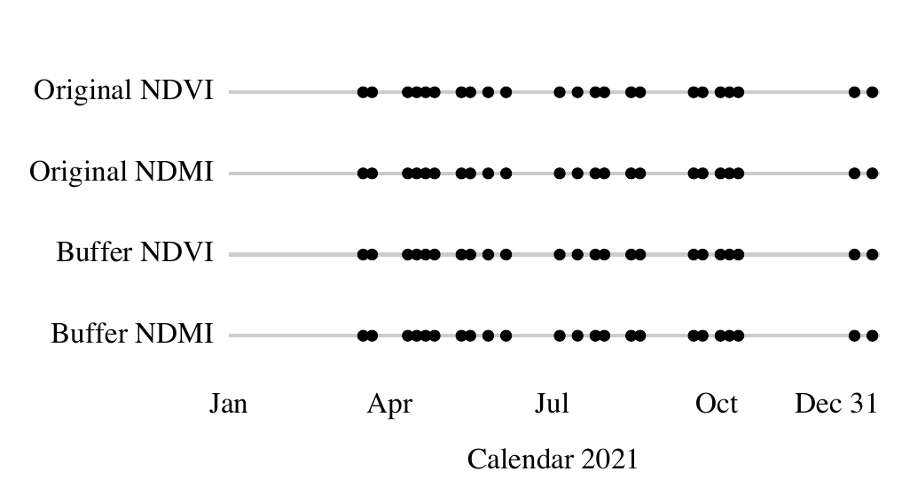

# Evaluating Satellite Observation Delivery for Rice Field Monitoring with Matani

**Updated:** 2026-09-17
**Status:** Phase 7 editorially revised full-paper review draft. Author details are carried forward provisionally from thesis fix-2.pdf. Venue compliance and thesis-team approval remain pending. Internal provenance annotations are omitted from the formatted paper and retained here for audit.

## Abstract

Satellite monitoring applications may withhold an otherwise usable observation when a companion index fails quality checks. This study examines that choice in Matani, a mobile application for rice-field monitoring. We compared complete-pair delivery, which requires both the Normalized Difference Vegetation Index (NDVI) and Normalized Difference Moisture Index (NDMI) to pass, with independent delivery of each qualifying index. The retrospective analysis covered one mapped-rice block in Krangkeng, Indramayu, Indonesia, during 2021. Both policies used the same Sentinel-2 Level-2A observations and quality criteria. A 10 m inward buffer provided a second geometry for assessing sensitivity to pixel support. Of 71 acquisition dates in the 365-day window, 23 passed both indices and 48 failed both. The policies therefore provided identical calendar coverage of 6.30 percent under both geometries. The mean interval between qualifying observations was 12.95 days, with a maximum of 65 days. Buffering reduced geometric area by 55.82 percent but did not change the qualifying dates. Two interrupted downloads were recovered before analysis and remained quality rejected. Software tests separately assessed quality decisions, request recovery and date presentation. The results show that independent delivery offered no additional observations in this case. They also demonstrate the importance of reporting acquisition absence, quality rejection and interrupted processing separately when evaluating a monitoring application. Generalisation requires additional sites and observation periods. [OBS-69; OBS-70; OBS-71]

**Keywords:** Sentinel-2; rice monitoring; NDVI; NDMI; decision support; observation availability; provenance.

## I Introduction

Indonesia's rice production provides a substantial context for field-monitoring applications. Statistics Indonesia reported approximately 10.21 million hectares of harvested paddy area in 2023 [1]. Satellite observations offer one way to examine rice-growing areas, and the literature includes optical, radar and combined approaches [2]. For an application used to inspect an individual field, however, the immediate question is whether a dated observation can be presented with sufficient information about its origin and quality. National production totals and regional mapping results do not answer that operational question.

Matani was developed as a mobile decision-support application for padi-field time-series monitoring. It brings together saved field boundaries, satellite indices, weather information and field notes. Its satellite views present numerical observations and acquisition dates for inspection. Interpreting those observations requires care: a change in an index describes a change in spectral response, while attributing it to a crop condition requires additional evidence. This study therefore examines the availability and presentation of observations as a foundation for the application's decision-support role. [DEC-14; DEC-24]

Information delivery is a practical part of that role. In a study of UK farmers and advisers, Rose et al. identified usability and relevance among the factors affecting uptake of agricultural decision-support tools [3]. Their findings motivate attention to the information users receive, although adoption in Indonesia remains a separate question. In a satellite application, a successful data request may yield no observation that meets the quality criteria. Alternatively, one index may meet those criteria while another fails. A rule requiring a complete pair would withhold the qualifying index in the latter case.

We compare two delivery policies on identical satellite inputs. Complete-pair delivery presents NDVI and NDMI only when both satisfy the quality criteria. Independent delivery presents each qualifying index, leaving its missing companion absent. The primary research question is how much calendar-day coverage differs between these policies for the selected case. Secondary questions concern intervals between observations, sensitivity to an inward buffer and correct handling of the resulting data in Matani. The comparison evaluates a proposed change to the existing complete-pair policy. [DEC-49; research-protocol §19–20]

The analysis covers one mapped-rice block in Krangkeng, Indramayu, during 2021. Its contribution is a documented comparison of delivery policies, supported by daily accounting and tests of the relevant software behavior. The case produced no dates on which only one index qualified, so the policies delivered identical coverage. Reporting this outcome helps determine whether a proposed change actually provides additional information under the conditions examined. The study addresses observation availability; agronomic accuracy, usability and wider operational reliability require different evaluations. [OBS-70; OBS-71; DEC-49]

## II Literature Review

### A Spectral indices and measurement meaning

Sentinel-2 bands have different spatial resolutions. The red B04 and near-infrared B08 bands are supplied at 10 m, while short-wave infrared B11 and the Scene Classification Layer are supplied at 20 m [4]. This affects the spatial support available for an index, particularly within a small analysis area. An output raster's nominal resolution should therefore be read alongside its source bands, resampling method and pixel-selection rule. These processing choices determine which cells contribute to the field summary and are reported explicitly in the methods.

The Normalized Difference Vegetation Index (NDVI) expresses the contrast between near-infrared and red reflectance. The Sentinel-2 implementation uses the normalized difference of B08 and B04 [5]. In Matani, each value is associated with its acquisition date, allowing the user to inspect observations over time. The application's quality criterion determines whether enough eligible pixels are available to calculate and display the value. It does not classify a field by disease, nutrient deficiency or rice growth stage. [DEC-24; DEC-49]

Moisture-index terminology also needs a precise band definition. Gao's vegetation-water index, NDWI, was formulated using reflectance near 0.86 and 1.24 micrometres [6]. Matani uses the Sentinel-2 B08/B11 formulation of the Normalized Difference Moisture Index (NDMI). This follows the formula in the source description [7]; its example scripts instead use B8A/B11, so the band choice must be stated explicitly. USGS describes the corresponding near-infrared/short-wave-infrared ratio for Landsat using that sensor's band assignments [8]. The underlying comparison is related, but the wavelengths and sensor implementations differ. Accordingly, this paper uses NDMI consistently for its B08/B11 calculation and does not interpret the index as a direct measurement of root-zone water content.

NDVI and NDMI are treated here as complementary spectral observations. Eligibility for display requires source data, an accepted scene classification, sufficient valid pixels and a finite calculation. These requirements define a reproducible processing rule. Assessing how accurately the resulting indices describe a crop would additionally require a target variable and corresponding field measurements. This distinction separates the present availability analysis from agronomic validation while identifying the evidence needed for a later study of crop condition. [DEC-24; research-protocol §19–20]

### B Rice mapping and prediction studies

Reviews by Kuenzer and Knauer [9] and Zhao et al. [2] place rice-area mapping within a broader remote-sensing literature. Zhao et al. discuss optical, microwave and integrated approaches. Rice maps are useful inputs for locating candidate study areas, whereas a monitoring application must also account for observations available within those areas on particular dates. This study uses a published map for site selection and evaluates the subsequent observation sequence. The map's role is to identify a rice-labelled area, with its classification and temporal limitations carried into the study design.

Thorp and Drajat provide a geographically relevant example from West Java. Their study combines agricultural survey information with Sentinel imagery to map rice production stages [10]. The survey information links the satellite observations to an agricultural interpretation. Our study shares the Indonesian rice context but examines the earlier processing question of which dated observations satisfy a specified display rule. Comparing these purposes helps distinguish the evidence needed for stage mapping from the evidence needed to describe observation availability.

Several studies connect spectral indices to agricultural outcomes through additional measurements and modelling. Guan et al. examine relationships between UAV-derived NDVI, fertilizer application and rice or wheat yield [11]. Huang et al. use NDVI time series and historical yield records to model provincial rice yields in China [12]. Ryu et al. investigate rice heat damage in a temperature-gradient field chamber [13]. Together, these examples illustrate how index observations are combined with reference information to address a defined agronomic question. Their acquisition platforms and study scales differ, so their findings cannot be used directly as thresholds for Matani's field-level display.

Observation gaps are another recurring concern. Soriano-González et al. report limitations associated with Sentinel-2 gaps in an Ebro Delta rice study [14]. Tsardanidis et al. investigate reconstruction from Sentinel-1 and Sentinel-2 for grassland monitoring [15]. Gap filling aims to estimate information between available observations. Our comparison instead retains the observed dates and asks whether a delivery rule suppresses any qualifying index. These approaches address different sources of incompleteness: reconstruction estimates missing values, while independent delivery changes access to values already calculated. No reconstructed observations enter the coverage analysis. [DEC-49]

### C Decision support and information presentation

Zhai et al. review agricultural decision-support systems and their development challenges [16]. Gutiérrez et al. discuss agricultural visualisations from a human-computer interaction perspective, including the communication of uncertainty [17]. These perspectives connect data processing with the information a person sees. For Matani, acquisition dates, quality status and missing values are central to that connection. A chart can contain the correct numbers yet convey a misleading sequence if it gives irregular observations equal spacing or joins them across long gaps. Presentation behavior is therefore included in the technical evaluation, alongside the policy comparison.

Cucho-Padin et al. describe UAV multispectral sensing and processing tools for smallholder agriculture [18]. IrrigaSys combines weather-driven irrigation modelling, Sentinel-2 NDVI and several information-delivery channels [19]. These systems illustrate different ways to connect observations with agricultural activities. They also show why a comparison must specify the particular function being assessed. The present study compares two policies defined for Matani; it does not reproduce either external system or assume how those systems handle an independently qualifying index. The complete-pair baseline is established from Matani's implementation. [CODE: backend/measurement/statistics.js; OBS-71]

Rose and Bruce emphasize user workflows and evaluation with actual users when developing decision-support systems [20]. This has a direct implication for interpreting our software tests. Tests can establish that a missing value remains absent or that a point is placed at the correct date. Assessing whether farmers understand the display and use it in a decision requires participants, tasks and suitable outcome measures. The present study provides the technical assessment; a user evaluation remains necessary to assess Matani's effectiveness in field use.

### D Comparable applications and weather context

Existing applications provide additional context. EO Browser supports satellite browsing and statistical exploration [21]. OneSoil's NDVI API describes image searches using date and cloud-related parameters [22]. Plantix advertises diagnosis and treatment information based on crop photographs [23]. These descriptions identify distinct functions: exploration of imagery, access to vegetation observations and interpretation of crop images. Matani focuses on a saved field's dated observations and associated context. The comparison here concerns that delivery function, rather than a ranking of the external products or their advertised effectiveness.

Weather adds context to field observations. Chou et al. study temperature and precipitation extremes in Chinese rice-growing regions using climate-model scenarios [24]. That work concerns climate exposure at a different scale from Matani's day-to-day information display. Matani obtains model-based temperature, precipitation, humidity and wind information through Open-Meteo [25] and its backend. Its weather-risk indicator is a separate, uncalibrated heuristic. Weather information is not used to replace a missing satellite value or determine whether an observation passes the NDVI/NDMI quality rule. [HYP-07; CODE: backend/api/weather/route.js]

### E Position of the present study

The literature supports three distinct questions: where rice is mapped, how spectral observations relate to agricultural variables, and how information reaches users. This study addresses the third question through the availability of observations from a mapped-rice area. The review is targeted to that purpose and draws on the accessible articles, author summaries and technical documentation listed in the references. Its synthesis motivates an explicit delivery-policy comparison without assuming that a more permissive policy will necessarily increase the observations available in a particular case. [DEC-49]

## III Matani System and Study Methods

### A GROW workflow and system boundary

Matani uses GROW to organise its information workflow: Gathering, Recognizing, Offering and Warning. Gathering associates a saved field boundary with satellite observations, weather information and notes. Recognizing supports inspection of dated values and changes between observations. Offering presents contextual information for the user's consideration. Warning presents weather-related information, including a heuristic indicator whose agricultural calibration remains outside this study. GROW is the workflow defined for Matani in this thesis. The experiment focuses on the satellite information entering Gathering and Recognizing; it does not evaluate the effectiveness of recommendations or warnings. [DEC-14; DEC-24; HYP-07]

Matani separates mobile presentation, backend processing and data storage. The Expo application provides field interaction and observation views. An Express backend handles authenticated requests and access to external providers, while Supabase provides identity and persistence. Saving a field or requesting a retry initiates measurement processing. The application then reads the resulting observation records. Because processing is asynchronous, acknowledging a request and completing an observation are separate events. The interface must preserve that distinction while processing is pending or unsuccessful. [CODE: backend/app.js; backend/api/measurements/route.js; utils/backend-api.ts; app/detail-lahan-page.tsx]

The implemented quality function makes a joint decision using NDVI and NDMI. The database observation view exposes both means only when the record passes this rule. Complete-pair delivery is therefore the existing policy, and independent delivery is evaluated offline as an alternative. The research calculations use retained provider rasters rather than newly inserted application records. Both policies are applied to those same rasters, keeping the empirical comparison separate from the application's scheduling and storage behavior. [CODE: backend/measurement/statistics.js; supabase/migrations/20260830000100_m2_measurement_pipeline.sql; OBS-71]

The application distinguishes test data from satellite measurements and preserves unavailable results without substituting numerical values. For a measured observation, the stored information must identify its source and processing history. In this study, the historical satellite analysis and the software evaluation provide separate forms of evidence: the former establishes the observation sequence, while the latter checks selected processing and presentation behavior. Table I summarises the inputs relevant to this distinction. Repeated operation on a mobile device was not evaluated. [DEC-24; project-architecture §2; OBS-71]

Table I. Inputs and interpretation in Matani

| Input | Presented information | Boundary |
|---|---|---|
| Satellite record | Dated NDVI and NDMI | Quality and source provenance required |
| Provider weather | Weather context | Model output, not a plot sensor |
| Field geometry | Location and boundary | User-defined or map-derived geometry |
| Field notes | Recorded context | Not independent validation in this study |
| Test fixture | Controlled behavior | Excluded from empirical coverage |

### B Research design and analysis unit

The study uses a retrospective case design without participant recruitment. Both policies receive the same dated observations, index formulas, quality decisions and source checks. Two masks are applied to each returned raster to compare the original area with an inward-buffered area. The primary outcome is the difference in calendar-day coverage between policies. Secondary outcomes are complete-pair coverage, per-index coverage, observation gaps and pixel counts. These descriptive outcomes are calculated for the selected block and year, with the site and processing settings established before examining the index results. [DEC-49; research-protocol §19–20]

The study area was selected from Open-SEA-Rice-10, a rice cropping-intensity map developed using 2020–2021 Sentinel-1/2 data [26]. Its dataset record identifies the map year as 2021 and declares a CC BY 4.0 licence [27]. We used positive rice classes to locate a contiguous candidate block and retained the dataset attribution. The selected geometry is a rectangle derived from the map, rather than a surveyed field boundary. The map supports identification of a rice-labelled area but does not verify continuous cultivation or crop condition throughout the observation year. [EVID-060; EVID-061]

The study examined a 3,557.38 m² mapped-rice block in Krangkeng, Indramayu, Indonesia, centred at approximately 6.50021° S, 108.50562° E. The block comprised a six-by-six-cell rectangle in the source map. Candidate selection used nine previously inspected 256-by-256-cell windows across three Java tiles. Each window was partitioned into non-overlapping six-by-six-cell blocks, excluding incomplete strips at its edges. In saved window order and then row and column order, the first block containing only positive rice classes was retained for each tile. The first candidate in tile order became the study block before its satellite availability results were obtained. This procedure selected contiguous mapped rice by convenience and does not constitute random sampling of farms. [OBS-54; OBS-56; DEC-49]

The observation window covers 1 January through 31 December 2021. All acquisition dates are grouped in UTC, giving 365 calendar dates for coverage calculations. The original and buffered geometries share this period and source collection. Every empirical coverage result therefore refers to the same block-year case. Neither the four geometry/index series nor the two delivery policies are additional sites or independent field replicates. [DEC-49; OBS-69; OBS-72]

### C Geometry and raster support

The field geometry is represented in GeoJSON, which specifies longitude and latitude in WGS84 [28]. Area calculations, buffering and raster requests use WGS84 / UTM zone 49S (EPSG:32749), so distances are expressed in metres. A 10 m inward buffer reduces the polygon area to 1,571.63 m², a loss of 55.82 percent. This distance defines a single spatial sensitivity analysis: it removes boundary-adjacent portions of the selected rectangle while preserving the original processing criteria. It was not selected by comparing the resulting observation counts. [OBS-58; DEC-49]

The original polygon's bounding box is expanded to coordinates at 20 m intervals. For each acquisition date, a common extent is requested for both indices, with NDVI output at 10 m and NDMI output at 20 m. The original and buffered masks are then applied locally to each raster. This ensures that the geometry comparison within an index uses subsets of the same cells. Requesting separately clipped rasters for each polygon could change grid placement as well as the selected area; using a shared raster avoids that additional difference. [research-protocol §20; OBS-62]

A cell is included when its centre lies inside or on the polygon boundary. This rule counts whole cells and does not weight them by the proportion intersecting the polygon. Before masking, each TIFF is checked against the requested dimensions, coordinate reference system, scale and origin. A mismatch is treated as a processing failure requiring investigation. After a raster passes these checks, its geometrically selected cells can be assessed for source presence and scene quality. Keeping these steps separate prevents a grid error from being counted as a rejected satellite observation. [research-protocol §20; OBS-62; OBS-69]

### D Acquisition and index processing

The catalogue inventory covers the original study area and the full observation period. We retrieved all result pages using the Catalog API's continuation mechanism [29] and retained item identifiers. No cloud-percentage filter was applied. The query returned 142 catalogue items on 71 distinct UTC dates. Daily accounting uses dates rather than item totals, avoiding multiple counts when more than one catalogue item occurs on the same day. The remaining calendar dates are classified as having no acquisition returned by this query. [OBS-63]

The Process API specifies the requested extent, source data, processing and output [30]. An Evalscript defines the bands and calculations performed on each cell [31]. We used the index formulas implemented in Matani, harmonized Level-2A reflectance and nearest-neighbour resampling. Equations (1) and (2) give the calculations. In the NDMI raster, B08 and B11 contribute to a 20 m output grid despite their different native resolutions. The common output spacing makes their calculation possible without implying that the original bands were acquired at identical resolution. [CODE: backend/measurement/cdse-process-adapter.js; research-protocol §20]

NDVI = (B08 − B04) / (B08 + B04)    (1)

NDMI = (B08 − B11) / (B08 + B11)    (2)

Source presence is checked using the provider's dataMask [32]. Scene quality is assessed from the Scene Classification Layer (SCL) [33]. We exclude classes 0, 1, 3, 8, 9 and 10 and retain water class 6. These class choices are fixed for both geometries and delivery policies. Retaining water is a processing choice, not a claim that every water-class pixel supports an agricultural interpretation. No additional cloud-percentage filter is introduced after inspecting the returned values. [research-protocol §20]

A valid index cell must be geometrically included, contain source data, pass the scene mask and produce a finite value with a nonzero denominator. Display eligibility requires at least nine valid NDVI cells and three valid NDMI cells. These thresholds are inherited from the application's processing rule and remain provisional technical choices, rather than calibrated accuracy criteria. We retain them to compare delivery policies under the existing implementation. Table II records the common processing settings. [DEC-49; CODE: backend/measurement/statistics.js]

Table II. Processing specification

| Setting | Value |
|---|---|
| Calendar period | 2021, 365 UTC days |
| Metric coordinate system | EPSG:32749 |
| Inward buffer | 10 m |
| Output grids | NDVI 10 m; NDMI 20 m |
| Inclusion rule | Pixel center covered by polygon |
| SCL exclusions | 0, 1, 3, 8, 9, 10 |
| Valid-cell floors | NDVI 9; NDMI 3 |
| Resampling | Nearest neighbor |
| Temporal filling | None |

The Statistical API can return aggregates while accounting for excluded pixels [34]. For this experiment, we retained Process API rasters so that both polygon masks could be applied to the same returned cells and the resulting counts could be inspected locally. This choice also preserves the inputs needed to reproduce the geometry comparison. A successful API response enters the analysis only after the raster and source checks; response success alone is insufficient for display eligibility. [DEC-49; OBS-69]

### E Provenance and recovery

NDVI and NDMI outputs must match in scene, product, source path, service version and acquisition time before they are accepted as a pair. Both geometry variants are derived from those matched outputs. A missing identifier, multiple-source ambiguity or source mismatch is retained as unresolved until investigated. Stored requests, responses and processing settings link the reported summaries to the source rasters. These checks establish which observations were compared and allow the calculations to be reproduced from the retained collection. [research-protocol §20; OBS-69]

Two NDVI requests were interrupted during collection. Each was repeated once with the same request body, and the recovered output was checked against the previously retained NDMI source information. Both retries succeeded, but neither recovered observation met the quality criteria. The original failures and recovered responses were preserved, completing the inventory without adding qualifying dates. The cause of the interruptions was not established. [DEC-52; OBS-67; OBS-68; OBS-69]

The completed collection accounts for all 365 dates and contains no unresolved processing cases. Its integrity is recorded with a SHA-256 checksum, linked to the source records and analysis outputs. W3C PROV provides a conceptual distinction between data entities and the activities that produce them [35], while the FAIR principles address discoverability, accessibility, interoperability and reuse [36]. We use these concepts to describe the retained processing history. The collection remains in a local research archive; recording its history and checksum does not by itself make it publicly accessible or establish formal compliance with either framework. [OBS-69]

### F Delivery policies and outcomes

Let N(d,g) and M(d,g) be binary indicators that NDVI and NDMI pass on date d for geometry g. Let J(d,g) denote joint eligibility and A(d,g) denote any-index eligibility under independent delivery. Equations (3) and (4) define these conditions. Joint delivery displays both indices when J is one and neither otherwise. Independent delivery displays the passing index or indices when A is one. It neither invents a missing companion nor carries an older observation forward. Complete pairs additionally require the source compatibility described above. [research-protocol §19–20]

J(d,g) = N(d,g) × M(d,g)    (3)

A(d,g) = max{N(d,g), M(d,g)}    (4)

Calendar coverage for an eligibility indicator Q is 100 times the sum of Q across the 365 dates divided by 365. We calculate any-index coverage, complete-pair coverage and separate NDVI and NDMI coverage. The policy difference is independent minus joint in percentage points. The buffer interaction is the buffered policy difference minus the original policy difference. Complete-pair coverage must remain identical between policies on the same fully resolved inputs, because changing whether a singleton is displayed does not create its missing companion. [research-protocol §19; OBS-70]

Table III gives the possible display outcomes for matched inputs. A date on which neither index passes has no displayed value under either policy. This includes quality-rejected acquisitions, while dates without an acquisition are accounted for separately in the calendar inventory. The distinction permits the analysis to attribute unavailable dates to the appropriate recorded state. The logical cases in the table also define software-test scenarios, including single-index cases absent from the observed dataset. [DEC-49; OBS-71]

Table III. Delivery logic for source-compatible inputs

| NDVI passes | NDMI passes | Joint output | Independent output |
|---|---|---|---|
| Yes | Yes | Both | Both |
| Yes | No | Neither | NDVI |
| No | Yes | Neither | NDMI |
| No | No | Neither | Neither |

### G Gaps and technical verification

Observation gaps are the differences in days between consecutive qualifying dates. We report their mean, median and maximum. Leading absence is measured from the beginning of the calendar window to the first qualifying date; trailing absence covers the period after the last qualifying date. These quantities describe different parts of the sequence. A gap statistic requires at least two qualifying dates. If processing remained unresolved, coverage would be reported as lower and upper bounds based on the missing cases. All processing was resolved here, so those bounds coincide. [research-protocol §19; OBS-70]

The software evaluation uses controlled inputs to test the implemented quality calculation, background processing and presentation components. Scenarios cover complete pairs, individual-index rejection, rejection of both indices, absent acquisitions, duplicate or concurrent requests, interrupted processing and irregular observation dates. The database view was reviewed through its SQL definition. Presentation components were tested with simulated rendering dependencies rather than on a native device. This design permits repeatable tests of specific behaviors while keeping the test inputs separate from the satellite observation sample. [OBS-71]

## IV Results

### A Inventory and coverage

Of the 365 calendar dates, 71 had acquisitions returned by the query and 294 did not. All 71 acquisition dates yielded source-compatible index pairs after processing and recovery. Of these, 23 passed both indices and 48 failed both. No date qualified for only one index under either geometry. Table IV reports this daily accounting. Source compatibility and quality acceptance are separate stages: only the 23 qualifying pairs contribute displayed observations to the coverage calculation. [OBS-69; OBS-70]

Table IV. Calendar accounting for the study period

| Category | Days |
|---|---:|
| Total calendar window | 365 |
| No acquisition in completed query | 294 |
| Source-verified acquisition dates | 71 |
| Both indices pass | 23 |
| Both indices quality rejected | 48 |
| Exactly one index passes | 0 |
| Unresolved processing | 0 |

Table V reports the coverage comparison. Both geometries yield 23 qualifying dates under each policy, equivalent to 6.30 percent of the year. Each of these dates supplies two index values, giving 46 values per geometry/policy combination. Any-index, complete-pair and individual-index coverage coincide because no single-index date occurs. The independent-minus-joint difference is zero percentage points, as is the change in that policy difference after buffering. [OBS-70]

Table V. Calendar coverage by geometry and policy

| Geometry | Policy | Any days | Pair days | Coverage |
|---|---|---:|---:|---:|
| Original | Joint | 23 | 23 | 6.30% |
| Original | Independent | 23 | 23 | 6.30% |
| Buffered | Joint | 23 | 23 | 6.30% |
| Buffered | Independent | 23 | 23 | 6.30% |

Among the 71 acquisition dates, 23 qualified, giving a conditional passing fraction of 32.39 percent. This answers how often a returned acquisition passed the quality criteria. Calendar coverage instead includes the dates with no returned acquisition and uses all 365 days as its denominator. Reporting both measures distinguishes the frequency of acquisition from eligibility after acquisition. The 46 individual index values remain paired on 23 dates and are not counted as 46 days of coverage. [OBS-70]

### B Temporal gaps

The qualifying dates are identical across geometries and policies. Their mean consecutive interval is 12.95 days, the median is 10 days and the maximum is 65 days. There are also 75 leading absent days and four trailing absent days. Fig. 1 locates the qualifying observations within the full calendar year. The four rows show the original and buffered NDVI and NDMI series; their coincidence makes the shared timing visible. All dots represent qualifying acquisition dates, with no interpolation between them. [OBS-70]

Fig. 1. Passing dates for the original and buffered NDVI and NDMI series. Both delivery policies coincide. The axis retains the full 2021 calendar; dots show qualifying dates rather than crop condition. Source: authors’ analysis of the 2021 Sentinel-2 observations. [OBS-70]

The 65-day maximum describes a gap within the observed sequence, while the 75-day leading absence occurs before the first qualifying date. Together, they show how a moderate average interval can coexist with extended periods without a displayed observation. These are historical gaps in availability, rather than processing delays or estimates of future service performance. [OBS-70]

### C Buffer sensitivity

Buffering reduces area by 55.82 percent and source-present cell counts from 36 to 16 for NDVI and from nine to four for NDMI. Table VI summarises valid-cell counts over the 71 acquisition dates. The mean declines for both indices after buffering, and the median is zero for all four series. Nevertheless, the same 23 dates satisfy the display thresholds. Spatial support therefore changes substantially even though the binary eligibility outcome remains unchanged. [OBS-58; OBS-70]

Table VI. Pixel support across acquisition dates

| Series | Source cells | Mean valid | Median valid |
|---|---:|---:|---:|
| Original NDVI | 36 | 11.746 | 0 |
| Buffered NDVI | 16 | 5.211 | 0 |
| Original NDMI | 9 | 2.930 | 0 |
| Buffered NDMI | 4 | 1.310 | 0 |

This result separates two effects of buffering. The number of cells contributing to the calculation decreases, but no acquisition crosses the eligibility threshold. Thus, coverage alone does not capture the change in spatial support. The comparison retains the original thresholds and buffer distance throughout; it provides no direct assessment of whether the remaining pixels better represent rice or agree more closely with field measurements. [DEC-49; OBS-70]

### D Recovery and technical checks

The two recovered NDVI outputs matched the source identities of their retained NDMI companions. Both remained quality rejected, so recovery changed the completeness of the inventory rather than its qualifying-date count. This matters for the final denominator: unresolved processing could have concealed an eligible date, whereas a completed, rejected calculation supplies a known outcome. The final coverage result includes no unresolved cases. [OBS-67; OBS-68; OBS-69]

All 46 backend tests and 35 repository-level tests passed, along with frontend type checking and lint checks. At the quality boundary, inputs containing nine valid NDVI cells and three valid NDMI cells passed. Cases with nine and two cells, or eight and three cells, were rejected by the complete-pair rule. Background-processing tests checked reuse of duplicate and concurrent requests and simulated interruption and recovery. Presentation tests retained numerical zero, omitted missing values and used acquisition time rather than record-creation time. Table VII summarises the tested components and their evaluation conditions. [OBS-71]

Table VII. Technical evaluation evidence

| Component | Finding | Evaluation |
|---|---|---|
| Quality function | Complete passes; partial rejects | Controlled inputs |
| Background processing | Reuse and recovery exercised | Simulated provider and storage |
| Database view | Both means require joint pass | Static SQL inspection |
| Presentation | Zero retained; null absent | Simulated rendering dependencies |
| Date chart | Elapsed spacing; unjoined dots | No native-device render |

The tests identified a date-presentation defect: the field-detail chart originally gave records equal horizontal spacing and connected them across missing dates. The corrected chart places points according to elapsed acquisition time and leaves them unconnected. Its axis spans the first and last numerical observations, whereas Fig. 1 spans the full year to show the study window. This correction improves the temporal representation checked by the software tests. Whether users understand that representation remains a question for interface evaluation. [OBS-71]

## V Discussion

### A Meaning of the zero policy difference

Independent delivery adds a displayed date only when exactly one index qualifies. Since this case contains no such dates, the equal coverage follows from the observed quality decisions. The result provides a direct answer to the primary research question for the selected block and year: complete-pair delivery withheld no additional qualifying dates. It is a descriptive equality under the specified settings, rather than a statistical equivalence result or evidence that the policies will always perform alike. [OBS-70; DEC-49]

The single-index software tests and the empirical result serve different purposes. Controlled inputs establish how the complete-pair implementation behaves when only one index qualifies. The satellite collection establishes whether that situation actually occurred in the case studied. Keeping these purposes separate avoids using a constructed example as evidence of a measured coverage gain. The implementation handles the tested partial inputs as specified, but the observed collection offers no additional dates for independent delivery to expose. [OBS-70; OBS-71]

The two indices share an acquisition context and related source-presence and scene-quality checks. Their decisions may therefore be related, even though they use different spectral bands and output resolutions. In this case, every date either passes both or fails both. The comparison does not isolate how much of that agreement arises from the shared scene mask, the pixel thresholds or other processing choices. Investigating those mechanisms would require a separate analysis of the rejected pixels and alternative specifications. [research-protocol §20; OBS-70]

### B Availability and temporal interpretation

The coverage measures give complementary accounts of availability. Calendar coverage combines acquisition frequency and post-acquisition eligibility. The acquisition-conditioned fraction describes only the second stage. Observation gaps add the timing information that either percentage omits. In this case, the 6.30 percent calendar coverage and 32.39 percent conditional fraction coexist with a 65-day internal gap and a 75-day leading absence. A user inspecting the sequence would encounter these extended absences even though the mean interval is considerably shorter. [OBS-70]

Matani should therefore present the acquisition date and availability state alongside each observation. Zero must remain distinguishable from a missing value, and the chart should preserve the spacing between observed dates. The corrected presentation addresses these requirements at the software-test level. A subsequent user study could examine whether the date labels, gaps and quality status help people recognise when information is unavailable. The current results describe historical availability and do not justify a promised monitoring interval. [DEC-24; OBS-71]

### C Geometry and validity limits

The study's principal limitation is its single, map-selected block. The rectangle is not a surveyed farm parcel, and the selection procedure favours contiguous positive rice classes in previously inspected windows. Open-SEA-Rice-10 also uses Sentinel-2 information [26], creating dependence between the selection source and the sensor being evaluated. There are no dated field observations confirming crop stage or condition for the acquisitions. Consequently, the results describe processing availability within the selected mapped area, with limited geographic and agricultural generalisability. [EVID-061; DEC-49]

The threshold and buffer choices impose further limits. The same absolute thresholds apply before and after buffering, even though buffering removes more than half the area. A passing buffered observation therefore requires a larger fraction of its available cells. This design answers how the existing rule behaves after a fixed geometric change; it does not identify an optimal buffer or minimum field size. Alternative thresholds could alter the passing dates and should be examined as a separate, declared sensitivity analysis. [OBS-58; OBS-70; DEC-49]

### D Operational and research reproducibility

The recovered requests show why transfer status should be recorded separately from quality status. An interrupted transfer supplies no basis for judging the missing observation. After recovery, the returned raster can be assessed using the original rule. Here, both interrupted cases became known rejections and the daily accounting was completed. The retained requests and responses make that change traceable without attributing the interruption to an unverified cause. [DEC-52; OBS-69]

The retained rasters support repetition of the local calculations, including the geometry masks, daily counts and policy comparison. Repeating the provider requests would additionally depend on service behavior and product revisions. Repeating the mobile workflow would involve authentication, scheduling, persistence and native presentation. Our evidence covers the local analysis and selected software components. The SQL review and simulated rendering tests leave database execution and repeatable device operation to subsequent verification. [OBS-69; OBS-70; OBS-71]

### E Further evaluation

A broader study should include additional blocks and years chosen using a declared sampling procedure. It should report both gains and zero differences under each processing specification, including cases where one index qualifies alone. Agronomic evaluation would require corresponding field measurements, and usability evaluation would require participants performing defined tasks. These additions would answer questions about agricultural interpretation and decision support that observation counts alone cannot address. [DEC-49; research-protocol §19–20]

Operational evaluation should test repeated device-initiated processing, database behavior and native rendering. If independent delivery is implemented, its storage and display must preserve the missing companion rather than substituting a value. The present case supports retaining clear missing-data handling while further cases are collected to determine whether the alternative policy provides a practical coverage gain. [OBS-70; OBS-71]

## VI Conclusion

For the mapped-rice block examined in Krangkeng during 2021, complete-pair and independent delivery produced identical observation coverage. Both indices qualified on 23 of 365 dates under the original and inward-buffered geometries, giving 6.30 percent calendar coverage. No date qualified for only one index. Buffering reduced pixel support without changing the qualifying dates, and the maximum interval between qualifying observations was 65 days. Recovery of two interrupted requests completed the inventory; both recovered observations remained rejected. [OBS-69; OBS-70]

The software evaluation confirmed the tested quality and recovery behavior and led to a correction in the display of irregular observation dates. Together, the analysis and technical tests show how a monitoring application can account for the information it presents and withholds. The empirical finding is specific to the selected block, year and processing settings. Further sites, field measurements and user evaluation are needed to assess wider availability, agricultural interpretation and decision-support effectiveness. [OBS-71; DEC-49]

## Data and Software Availability

The derived snapshot, original responses, requests, hashes and scripts are retained in the thesis team’s local research archive and have not been publicly deposited. Public access to the source Open-SEA dataset [27] does not imply public access to this derived collection. Release arrangements remain subject to review. [OBS-69; DEC-53]

## References

[1] BPS-Statistics Indonesia, “In 2023, paddy harvested area was approximately 10.21 million hectares with 53.98 million tons of dry unhusked paddy (GKG) production,” Mar. 1, 2024. https://www.bps.go.id/en/pressrelease/2024/03/01/2375/pada-2023--luas-panen-padi-mencapai- [EVID-067]

[2] R. Zhao, Y. Li, and M. Ma, “Mapping paddy rice with satellite remote sensing: A review,” Sustainability, vol. 13, no. 2, art. 503, 2021, doi: 10.3390/su13020503. https://mdpi-res.com/d_attachment/sustainability/sustainability-13-00503/article_deploy/sustainability-13-00503.pdf [EVID-068]

[3] D. C. Rose et al., “Decision support tools for agriculture: Towards effective design and delivery,” Agricultural Systems, vol. 149, pp. 165–174, 2016, doi: 10.1016/j.agsy.2016.09.009. https://discovery.ucl.ac.uk/id/eprint/1556099/ [EVID-069]

[4] Copernicus Data Space Ecosystem, “Sentinel-2 L2A,” technical documentation, accessed Sep. 17, 2026. https://documentation.dataspace.copernicus.eu/APIs/SentinelHub/Data/S2L2A.html [EVID-070]

[5] Sentinel Hub, “Normalized difference vegetation index,” Custom Scripts, accessed Sep. 17, 2026. https://custom-scripts.sentinel-hub.com/custom-scripts/sentinel-2/ndvi/ [EVID-071]

[6] B.-C. Gao, “NDWI—A normalized difference water index for remote sensing of vegetation liquid water from space,” Remote Sensing of Environment, vol. 58, no. 3, pp. 257–266, 1996, doi: 10.1016/S0034-4257(96)00067-3. https://modis.gsfc.nasa.gov/sci_team/pubs/abstract_new.php?id=03634 [EVID-072]

[7] Sentinel Hub, “Normalized Difference Moisture Index,” Custom Scripts, accessed Sep. 17, 2026. https://custom-scripts.sentinel-hub.com/custom-scripts/sentinel-2/ndmi/ [EVID-073]

[8] U.S. Geological Survey, “Normalized Difference Moisture Index,” Landsat Missions, accessed Sep. 17, 2026. https://www.usgs.gov/landsat-missions/normalized-difference-moisture-index [EVID-074]

[9] C. Kuenzer and K. Knauer, “Remote sensing of rice crop areas,” International Journal of Remote Sensing, vol. 34, no. 6, pp. 2101–2139, 2013, doi: 10.1080/01431161.2012.738946. https://elib.dlr.de/82597/ [EVID-075]

[10] K. R. Thorp and D. Drajat, “Deep machine learning with Sentinel satellite data to map paddy rice production stages across West Java, Indonesia,” Remote Sensing of Environment, vol. 265, art. 112679, 2021, doi: 10.1016/j.rse.2021.112679. https://www.ars.usda.gov/research/publications/publication/?seqNo115=382490 [EVID-076]

[11] S. Guan et al., “Assessing correlation of high-resolution NDVI with fertilizer application level and yield of rice and wheat crops using small UAVs,” Remote Sensing, vol. 11, no. 2, art. 112, 2019, doi: 10.3390/rs11020112. https://www.mdpi.com/2072-4292/11/2/112 [EVID-077]

[12] J. Huang, X. Wang, X. Li, H. Tian, and Z. Pan, “Remotely sensed rice yield prediction using multi-temporal NDVI data derived from NOAA’s AVHRR,” PLOS ONE, vol. 8, no. 8, art. e70816, 2013, doi: 10.1371/journal.pone.0070816. https://journals.plos.org/plosone/article?id=10.1371/journal.pone.0070816 [EVID-078]

[13] J.-H. Ryu et al., “Remote sensing-based evaluation of heat stress damage on paddy rice using NDVI and PRI measured at leaf and canopy scales,” Agronomy, vol. 12, no. 8, art. 1972, 2022, doi: 10.3390/agronomy12081972. https://www.mdpi.com/2073-4395/12/8/1972 [EVID-079]

[14] J. Soriano-González et al., “Monitoring rice crop and yield estimation with Sentinel-2 data,” Field Crops Research, vol. 281, art. 108507, 2022, doi: 10.1016/j.fcr.2022.108507. https://www.sciencedirect.com/science/article/pii/S0378429022000788 [EVID-050]

[15] I. Tsardanidis, A. Koukos, V. Sitokonstantinou, T. Drivas, and C. Kontoes, “Cloud gap-filling with deep learning for improved grassland monitoring,” Computers and Electronics in Agriculture, vol. 230, art. 109732, 2025, doi: 10.1016/j.compag.2024.109732. https://www.sciencedirect.com/science/article/pii/S0168169924011232 [EVID-064]

[16] Z. Zhai, J. F. Martínez, V. Beltran, and N. Lucas Martínez, “Decision support systems for agriculture 4.0: Survey and challenges,” Computers and Electronics in Agriculture, vol. 170, art. 105256, 2020, doi: 10.1016/j.compag.2020.105256. https://www.sciencedirect.com/science/article/pii/S0168169919316497 [EVID-080]

[17] F. Gutiérrez, N. N. Htun, F. Schlenz, A. Kasimati, and K. Verbert, “A review of visualisations in agricultural decision support systems: An HCI perspective,” Computers and Electronics in Agriculture, vol. 163, art. 104844, 2019, doi: 10.1016/j.compag.2019.05.053. https://www.sciencedirect.com/science/article/pii/S0168169918319069 [EVID-081]

[18] G. Cucho-Padin et al., “Development of low-cost remote sensing tools and methods for supporting smallholder agriculture,” Applied Geomatics, vol. 12, pp. 247–263, 2020, doi: 10.1007/s12518-019-00292-5. https://link.springer.com/article/10.1007/s12518-019-00292-5 [EVID-082]

[19] L. Simionesei, T. B. Ramos, J. Palma, A. R. Oliveira, and R. Neves, “IrrigaSys: A web-based irrigation decision support system based on open source data and technology,” Computers and Electronics in Agriculture, vol. 178, art. 105822, 2020, doi: 10.1016/j.compag.2020.105822. https://researchportal.ulisboa.pt/en/publications/irrigasys-a-web-based-irrigation-decision-support-system-based-on/ [EVID-049]

[20] D. C. Rose and T. J. A. Bruce, “Finding the right connection: What makes a successful decision support system?” Food and Energy Security, vol. 7, no. 1, art. e00123, 2018, doi: 10.1002/fes3.123. https://onlinelibrary.wiley.com/doi/abs/10.1002/fes3.123 [EVID-083]

[21] Sentinel Hub, “EO Browser,” product documentation, accessed Sep. 17, 2026. https://www.sentinel-hub.com/explore/eobrowser/ [EVID-084]

[22] OneSoil, “NDVI API,” API Guide, accessed Sep. 17, 2026. https://api-b2b.prod-be.onesoil.ai/docs/ndvi_api/ [EVID-085]

[23] Plantix, “Plantix,” product website, accessed Sep. 17, 2026. https://plantix.net/en/ [EVID-086]

[24] J. Chou et al., “Changes in extreme climate events in rice-growing regions under different warming scenarios in China,” Frontiers in Earth Science, vol. 9, art. 655128, 2021, doi: 10.3389/feart.2021.655128. https://www.frontiersin.org/journals/earth-science/articles/10.3389/feart.2021.655128/full [EVID-087]

[25] Open-Meteo, “Weather Forecast API,” documentation, accessed Sep. 17, 2026. https://open-meteo.com/en/docs [EVID-088]

[26] F. I. Ginting et al., “High-resolution maps of rice cropping intensity across Southeast Asia,” Scientific Data, vol. 12, art. 1408, 2025, doi: 10.1038/s41597-025-05722-1. https://www.nature.com/articles/s41597-025-05722-1 [EVID-061]

[27] F. I. Ginting et al., “Open-SEA-Rice-10: Open Access High-Resolution Maps of Rice Harvested Area and Cropping Intensity in Southeast Asia,” dataset, Zenodo, record 14627003, 2025, doi: 10.5281/zenodo.14627003. https://zenodo.org/records/14627003 [EVID-060]

[28] H. Butler, M. Daly, A. Doyle, S. Gillies, S. Hagen, and T. Schaub, “The GeoJSON format,” RFC 7946, 2016, doi: 10.17487/RFC7946. https://www.rfc-editor.org/rfc/rfc7946 [EVID-089]

[29] Copernicus Data Space Ecosystem, “Catalog API,” documentation, accessed Sep. 17, 2026. https://documentation.dataspace.copernicus.eu/APIs/SentinelHub/Catalog.html [EVID-065]

[30] Copernicus Data Space Ecosystem, “Processing API,” documentation, accessed Sep. 17, 2026. https://documentation.dataspace.copernicus.eu/APIs/SentinelHub/Process.html [EVID-090]

[31] Sentinel Hub, “Evalscript V3,” documentation, accessed Sep. 17, 2026. https://docs.sentinel-hub.com/api/latest/evalscript/v3/ [EVID-091]

[32] Sentinel Hub, “dataMask,” documentation, accessed Sep. 17, 2026. https://docs.sentinel-hub.com/api/latest/user-guides/datamask/ [EVID-092]

[33] Sentinel Hub, “Sentinel-2 L2A Scene Classification Map,” Custom Scripts, accessed Sep. 17, 2026. https://custom-scripts.sentinel-hub.com/custom-scripts/sentinel-2/scene-classification/ [EVID-093]

[34] Sentinel Hub, “Statistical API,” documentation, accessed Sep. 17, 2026. https://docs.sentinel-hub.com/api/latest/api/statistical/ [EVID-094]

[35] W3C, “PROV-Overview,” W3C Working Group Note, Apr. 30, 2013. https://www.w3.org/TR/prov-overview/ [EVID-095]

[36] M. D. Wilkinson et al., “The FAIR Guiding Principles for scientific data management and stewardship,” Scientific Data, vol. 3, art. 160018, 2016, doi: 10.1038/sdata.2016.18. https://www.nature.com/articles/sdata201618 [EVID-096]
